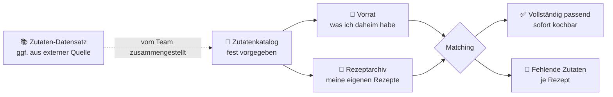

  

<h1 align="center">Jausi</h1>

  <strong>Rezepte mit dem, was du daheim hast.</strong>

> [!NOTE]
> **Auf einen Blick**
> - **Was:** App, die einen persönlichen Lebensmittelvorrat mit einem Rezeptarchiv verbindet und zeigt, welche Gerichte mit vorhandenen Zutaten möglich sind.
> - **Für wen:** Menschen, die unkompliziert mit dem kochen möchten, was sie daheim haben, allen voran Studierende.
> - **Wo:** hauptsächlich auf dem Smartphone, in der Küche und beim Einkaufen, auch ohne Internet.
> - **Stand:** Phase 1 (Anforderungen) ist abgeschlossen und am 13.11.2026 vom Team bestätigt. Es gibt noch keinen Code.

## Problem

Menschen, die unkompliziert kochen möchten, allen voran Studierende, verlieren leicht den Überblick über ihre Lebensmittel. Jausi beantwortet die Frage **„Was kann ich heute mit meinem Vorrat kochen?“** und unterstützt dabei, vorhandene Zutaten zu nutzen und unnötige Einkäufe zu vermeiden.

**Warum das relevant ist:**

- In österreichischen Haushalten werden pro Person und Jahr rund **69 kg Lebensmittel** weggeworfen, davon etwa **37 kg vermeidbar** ([BMLUK, Daten 2024](https://www.bmluk.gv.at/themen/abfall-und-kreislaufwirtschaft/abfallvermeidung/lebensmittel/oesterreich/haushalte.html)).
- In einer Umfrage der Verbraucherzentrale NRW wünschte sich rund **ein Drittel** der Befragten Rezepte zur Resteverwertung ([Verbraucherzentrale NRW](https://www.verbraucherzentrale.nrw/pressemitteilungen/neue-umfrage-fortschritte-bei-vermeidung-von-lebensmittelabfaellen-111819)).
- Laut einer Studie der ZHAW verschwenden **jüngere Menschen** mehr Lebensmittel als ältere ([ZHAW](https://www.zhaw.ch/de/medien/medienmitteilungen/detailansicht-medienmitteilung/event-news/frauen-ernaehren-sich-nachhaltiger-aeltere-verschwenden-weniger-nahrungsmittel/)).

Eine Erhebung speziell zu Studierenden liegt dem Team nicht vor.

## Zielgruppe

Alle Nutzer wollen drei Dinge wissen: **Was habe ich da? Was kann ich damit kochen? Was muss ich nachkaufen?** Drei fiktive [Personas](docs/personas.md) zeigen unterschiedliche Motivationen:

| Persona | Motivation |
| --- | --- |
| 🎓 **Lena, 22, Studentin** (primär) | will schnell entscheiden, was es heute gibt, und nur das Nötigste kaufen |
| 🌱 **Andrea, 38, berufstätig** | will vorhandene Lebensmittel aufbrauchen statt sie wegzuwerfen |
| 🍳 **Jonas, 19, Lehrling** | kocht erst seit Kurzem und will sein kleines Repertoire nutzen |

## So funktioniert Jausi

Zutaten werden beim Tippen aus einem fest vorgegebenen Zutatenkatalog vorgeschlagen. Das Team stellt ihn zusammen, für einen ausreichend großen Datensatz gegebenenfalls aus einer externen Quelle; eigene Zutaten anzulegen ist eine spätere Erweiterung. Das Matching prüft nur, **ob** eine Zutat vorhanden ist, nicht die Menge.

## Geplanter Funktionsumfang (MVP)

- Zutaten aus dem festen Zutatenkatalog im Vorrat erfassen und entfernen; passende Zutaten werden beim Tippen vorgeschlagen.
- Eigene Rezepte mit Zutaten, optionalen Mengenangaben und Zubereitung verwalten.
- Passende Rezepte finden und fehlende Zutaten anzeigen.
- Auf dem Smartphone nutzbar, auch ohne Internet.

**Bewusst nicht im MVP:** Mengenvergleich, eigene Zutaten anlegen und Suche nach Rezeptnamen (Should), Favoriten, Einkaufsliste und Kategorien (Could), Nutzerkonten. AI unterstützt die Projektarbeit; eine AI-Funktion in der App ist nicht vorgesehen. Details stehen im [MVP-Scope](docs/mvp.md).

## Projektdokumentation

| Dokument | Inhalt |
| --- | --- |
| [Anforderungen](docs/requirements.md) | Anwendungsfälle, Begriffe, User Stories, funktionale und nichtfunktionale Anforderungen |
| [MVP-Scope](docs/mvp.md) | Was im MVP ist und was nicht, Demo-Ablauf, Definition of Done, Entscheidungen der Teamprüfung |
| [Personas](docs/personas.md) | Lena, Andrea und Jonas im Detail |
| [AI-Einsatz](docs/ai-usage.md) | Wo und wie AI eingesetzt wurde, Prompts und kritische Bewertung |
| [Branding](docs/branding.md) | Logo- und Maskottchen-Ideen (nicht Teil des MVP) |
| [Architekturentscheidungen](docs/adr/README.md) | Verbindliche ADR-Vorlage und erste Entscheidungsvorschläge |
| [Zusammenarbeit auf GitHub](docs/github-workflow.md) | Pull Requests, CI-Prüfung, Schutz für main und Hosting-Optionen |

## Team

| Teammitglied | E-Mail |
| --- | --- |
| Manuela | se26m005@technikum-wien.at |
| Alex | se26m018@technikum-wien.at |
| Manuel | se26m026@technikum-wien.at |
| Roger | se26m063@technikum-wien.at |

In der Projektdokumentation verwenden wir ausschließlich Vornamen. Die Verantwortung für die Anforderungen liegt beim Team; AI liefert Vorschläge und unterstützt deren Prüfung.

## Projektstand

Phase 1 ist am 13.11.2026 vom Team bestätigt. Ein erster Architekturvorschlag ist auf ausdrücklichen Auftrag als ADR dokumentiert; daraus folgt keine Freigabe zur Umsetzung. Es gibt noch keinen App-Code. Die Termine stammen aus dem Kursplan und sind keine bestätigten Abgabefristen.

| Phase laut Kursplan | Datum | Stand |
| --- | --- | --- |
| 1 – Project Definition & Requirements | 14.10.2026 | ✅ abgeschlossen, vom Team bestätigt am 13.11.2026 |
| 2 – Architecture & Design | 09.11.2026 | – |
| 3 – AI-assisted/driven Implementation | 23.11.2026 | – |
| 4 – Quality Assurance & Testing | 09.12.2026 | – |
| 5 – Evaluation & Reflection | 21.12.2026 | – |
