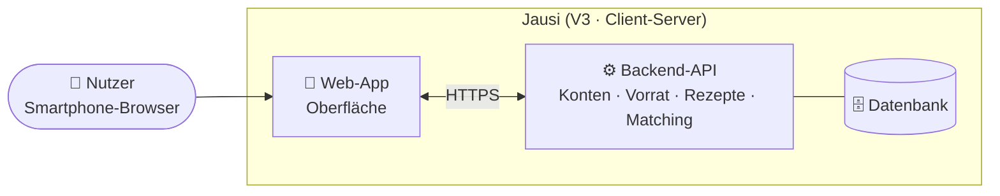
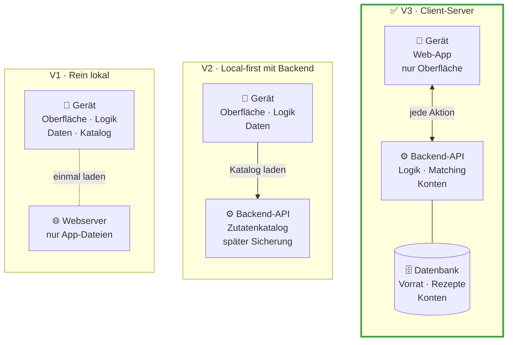

# Architektur

> [!NOTE]
> **Entwurf (Phase 2), Stand 13.11.2026**, mit AI erarbeitet. Der Architekturstil ist vorgeschlagen ([ADR-0002](adr/0002-architekturstil-client-server.md), gilt ohne Einwand ab 15.11.2026). Technologien, Architekturdiagramm, Datenmodell und Schnittstellen folgen. Vorgaben des Kurses: [kursvorgaben.md](kursvorgaben.md#phase-2--architecture--design).

## Ergebnis auf einen Blick

Die Entscheidung fällt in drei Ebenen, jede engt die nächste ein:

| Ebene | Frage | Vorschlag |
| --- | --- | --- |
| 1 · Architekturstil | Wo liegen Daten und Logik? | **Client-Server mit Konten** (V3, [ADR-0002](adr/0002-architekturstil-client-server.md)) |
| 2 · Plattform | Wie kommt Jausi aufs Smartphone? | **Web-App im Browser** für den MVP; eigene App danach |
| 3 · Technologien | Sprachen, Frameworks, Datenbank, Anmeldung | offen, folgt als **ein** ADR-0003 „Technologie-Stack“ |

**Begründung:** Jausi soll langfristig auf mehreren Geräten mit denselben Daten laufen, zuerst im Browser, später als eigene App. Client-Server erreicht das mit dem geringsten Umbau, passt zu den Kenntnissen des Teams (Web sowie Java oder C#, noch nicht für alle bestätigt) und liefert ein vollständiges API-Design. Dafür ist Offline-Nutzung im MVP kein Must mehr; das ist eine bewusste Scope-Änderung gegenüber Phase 1. Für die Zeit nach dem Kurs sind eine lesbare lokale Kopie (US-30) und ein Export aller Daten (US-29) vorgemerkt, damit die Daten nicht nur bei uns liegen.

### Architekturüberblick (V3)

Erste Sicht auf die gewählte Architektur, angelehnt an die Kontext- und Containersicht des C4-Modells. Sobald die Technologien feststehen, bekommen die Bausteine ihre konkreten Namen, und die Sicht wird um die Module der Backend-API ergänzt.

## Leitlinie: bewusst einfach

Der Kurs empfiehlt die einfachste Architektur, die die Anforderungen erfüllt. Für Jausi heißt das:

- **Ein Programm** liefert Oberfläche und API aus (modularer Monolith), mit klar getrennten Modulen für Konto, Zutatenkatalog, Vorrat, Rezepte und Matching.
- **Eine Datenbank**, ein Repository, ein Deployment.
- **Anmeldung über die Bausteine des Frameworks**, nicht selbst gebaut; das Konto dient nur der Anmeldung.
- **Matching als reine Logik** ohne Zugriff auf Oberfläche oder Datenbank, damit es automatisiert testbar ist (NFR-05).
- **Die Entwicklung der App wartet nicht auf die Infrastruktur.** Gebaut und getestet wird zuerst lokal; Hosting und Deployment kommen parallel dazu und dürfen die Umsetzung der Stories nicht blockieren.
- **Keine zusätzlichen Dienste** wie Message Queues, Caches oder eigene Microservices, solange keine Anforderung sie verlangt.

## Noch offen in Phase 2

Bewusst knapp, je etwa eine Seite:

- **ADR-0003 · Technologie-Stack:** eine Entscheidung für Sprache und Framework von Oberfläche und Backend, Datenbank und den Baustein für die Anmeldung, mit Begründung aus den Kenntnissen des Teams.
- **Datenmodell:** ein ER-Diagramm mit Konto, Zutat, Vorrat, Rezept und Rezeptzutat, aufbauend auf dem fachlichen Modell in [requirements.md](requirements.md#begriffe).
- **API-Design:** eine Tabelle der Endpunkte mit Methode, Pfad, Zweck und Bezug zur Story.
- **Hosting:** Entscheidung auf Basis des Vergleichs in `hosting.md`.

## Ebene 1 · Architekturstil

Gleiches Raster in allen Spalten: oben das Gerät, darunter der Server, unten die Datenbank. Von links nach rechts wandern Logik und Daten vom Gerät auf den Server.

| Kriterium | V1 · Rein lokal | V2 · Local-first mit Backend | V3 · Client-Server |
| --- | --- | --- | --- |
| Idee | Alles auf dem Gerät; ein Server liefert höchstens die App aus | Daten auf dem Gerät; eine kleine API liefert den Katalog, später Sicherung | Daten und Matching auf dem Server; die App ist die Oberfläche |
| Daten auf mehreren Geräten | ❌ | ❌ erst mit Synchronisierung | ✅ |
| Ohne Internet | ✅ | ✅ | ❌ im MVP; Lesen und Einkaufsliste später (US-30, US-28) |
| Datenverlust bei Geräteverlust | ⚠️ ja | ⚠️ ja | ✅ nein; dafür Server sichern |
| Konten und personenbezogene Daten | keine | keine im MVP | nötig, DSGVO (NFR-06) |
| Matching testbar (NFR-05) | ✅ | ✅ | ✅ |
| Bauteile und Betrieb | 1, kein Betrieb | 2, kleines Backend | 3, Backend und Datenbank |
| API-Design für den Kurs | nur Modulschnittstellen | Katalog-API | vollständige API |
| Späterer Weg zur eigenen App mit Konten | großer Umbau | Synchronisierung nötig, aufwendig | gleiche API, kein Umbau |

Verglichen wurde gegen die Anforderungen aus Phase 1. V3 widersprach dort der Offline-Nutzung als Must und dem MVP ohne Konten; die Scope-Änderung mit ADR-0002 löst das auf (Details in [requirements.md](requirements.md) und [mvp.md](mvp.md#entscheidungen-der-teamprüfung)).

## Ebene 2 · Plattform

Getestet wird auf Android und iPhone; eine reine Android- oder iPhone-App scheidet daher aus.

| Option | Speicherung auf dem Gerät | Verteilung | Passt zum Team |
| --- | --- | --- | --- |
| **Web-App im Browser** ✅ MVP | nur für die lokale Kopie (US-30); der Browser kann sie löschen | Link, kein Store | ✅ Web |
| **Web-App in App-Hülle** (z. B. Capacitor) | verlässlicher über ein natives Plugin | Store oder Testkanal; iPhone braucht ein kostenpflichtiges Apple-Konto | ✅ Web |
| **Plattformübergreifende App** (z. B. React Native, Flutter) | native Datenbank | wie App-Hülle | React Native: Web-Kenntnisse helfen; Flutter: neue Sprache |

Für die eigene App nach dem MVP kommen App-Hülle oder plattformübergreifende App in Frage; beide nutzen dieselbe Server-API. Mit der App-Hülle lässt sich der Web-Code weiterverwenden.

## Kritische Bewertung der AI-Beiträge

Der erste AI-Entwurf verglich nur Plattformen (PWA, App, Android-App), ließ eine Server-Variante weg und empfahl die PWA, bevor die Kenntnisse des Teams bekannt waren. Der Nutzer hat ihn zurückgewiesen. Daraus entstanden die drei Ebenen, der gleichwertige Vergleich von V1 bis V3 und die Option App-Hülle. Die Entscheidung für V3 kam vom Nutzer, nicht von der AI.

## Quellen

- [Ink & Switch: Local-first software](https://inkandswitch.com/local-first/)
- [RxDB: Grenzen von Local-first](https://rxdb.info/articles/local-first-future.html)
- [PowerSync: SQLite-Speicherung im Browser](https://powersync.com/blog/sqlite-persistence-on-the-web)
- [Vergleich React Native, Expo und Capacitor](https://www.pkgpulse.com/guides/react-native-vs-expo-vs-capacitor-cross-platform-mobile-2026)
- [Apple Developer Forums: Datenerhalt von Web-Apps unter iOS](https://developer.apple.com/forums/thread/710157)
