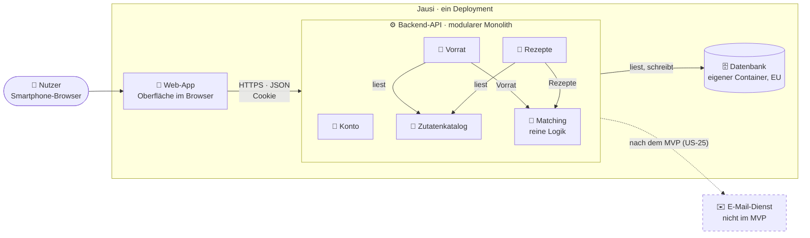
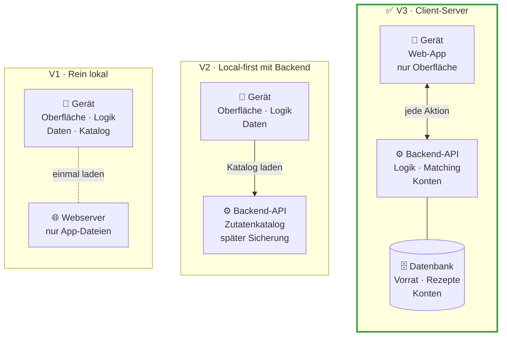

# Architektur

> [!NOTE]
> **Entwurf (Phase 2), Stand 13.11.2026**, mit AI erarbeitet, technologieneutral. Dazu gehören [Datenmodell](datenmodell.md), [API-Design](api.md), [Hosting](hosting.md) und die [ADRs](adr/README.md); Stand der Deliverables und offene Teamentscheidungen in [kursvorgaben.md](kursvorgaben.md#phase-2--architecture--design).

## Ergebnis auf einen Blick

Die Entscheidung fällt in drei Ebenen, jede engt die nächste ein:

| Ebene | Frage | Vorschlag |
| --- | --- | --- |
| 1 · Architekturstil | Wo liegen Daten und Logik? | **Client-Server mit Konten** (V3, [ADR-0002](adr/0002-architekturstil-client-server.md)) |
| 2 · Plattform | Wie kommt Jausi aufs Smartphone? | **Web-App im Browser** für den MVP; eigene App danach |
| 3 · Technologien | Sprachen, Frameworks, Datenbank, Anmeldung | [ADR-0003](adr/0003-technologie-stack.md), Teamprüfung offen |

**Begründung:** Jausi soll langfristig auf mehreren Geräten mit denselben Daten laufen, zuerst im Browser, später als eigene App. Client-Server erreicht das mit dem geringsten Umbau, passt zu den Kenntnissen des Teams (Stand in [ADR-0003](adr/0003-technologie-stack.md)) und liefert ein vollständiges API-Design. Dafür ist Offline-Nutzung im MVP kein Must mehr; das ist eine bewusste Scope-Änderung gegenüber Phase 1. Für die Zeit nach dem Kurs sind eine lesbare lokale Kopie (US-30) und ein Export aller Daten (US-29) vorgemerkt, damit die Daten nicht nur bei uns liegen.

## Leitlinie: bewusst einfach

Der Kurs empfiehlt die einfachste Architektur, die die Anforderungen erfüllt. Für Jausi heißt das:

- **Ein Programm** liefert Oberfläche und API aus (modularer Monolith), mit klar getrennten Modulen für Konto, Zutatenkatalog, Vorrat, Rezepte und Matching.
- **Eine Datenbank**, ein Repository, ein Deployment.
- **Anmeldung über die Bausteine des Frameworks**, nicht selbst gebaut; das Konto dient nur der Anmeldung.
- **Matching als reine Logik** ohne Zugriff auf Oberfläche oder Datenbank, damit es automatisiert testbar ist (NFR-05).
- **Die Entwicklung der App wartet nicht auf die Infrastruktur.** Gebaut und getestet wird zuerst lokal; Hosting und Deployment kommen parallel dazu und dürfen die Umsetzung der Stories nicht blockieren.
- **Keine zusätzlichen Dienste** wie Message Queues, Caches oder eigene Microservices, solange keine Anforderung sie verlangt.

## Komponenten und Verantwortlichkeiten

Containersicht nach C4: ein Programm (Web-App und API) und die Datenbank. **Modulregel:** Jedes Modul schreibt nur seine eigenen Tabellen; den Zutatenkatalog dürfen alle lesen. Einzige Ausnahme ist die Kaskade beim Löschen eines Kontos ([datenmodell.md](datenmodell.md#entitäten)). Matching bekommt Vorrat und Rezepte über deren Schnittstellen; alle Module erhalten das angemeldete Konto vom Modul Konto. Endpunkte je Modul: [api.md](api.md).

| Baustein | Verantwortung | Daten | Bezug |
| --- | --- | --- | --- |
| **Web-App** | Anzeige und Eingabe, mobil bedienbar; Hinweise am Feld, Sicherheitsabfragen, „Keine Internetverbindung“; Datenschutzerklärung und Impressum | keine dauerhaften | NFR-01, NFR-04, NFR-10, US-31/FR-22, US-32 |
| **Konto** | Registrieren, an- und abmelden, Konto löschen; liefert jeder Anfrage das angemeldete Konto; über den Baustein des Frameworks | Konto (E-Mail-Adresse, Passwort-Hash), Sitzung | US-23, US-24, US-26, FR-16; nach dem MVP US-25, FR-17 |
| **Zutatenkatalog** | Katalog bereitstellen, Zutatenvorschläge beim Tippen | Zutat, für alle Konten gleich, vom Team von Hand gepflegt | US-13, FR-01; nach dem MVP US-14, US-15, US-17, US-18 |
| **Vorrat** | Zutaten hinzufügen, anzeigen und entfernen; jede Zutat höchstens einmal | Vorratseintrag je Konto und Zutat | US-01–03, FR-02 |
| **Rezepte** | Rezepte anlegen, anzeigen, bearbeiten und löschen; Regeln für gültige Rezepte | Rezept, Rezeptzutat mit Menge als Freitext, je Konto | US-04–06, US-19, FR-03; nach dem MVP US-07, US-11, US-16 |
| **Matching** | Fehlende Zutaten je Rezept, Anzahl, Filter „vollständig passend“ | keine eigenen | US-08, US-09, FR-05, NFR-05; nach dem MVP US-10 |
| **Datenbank** | Alle Daten dauerhaft speichern und sichern | alle oben genannten | FR-06, NFR-03, NFR-06 |

Nach dem MVP bekäme die Einkaufsliste (Could) ein eigenes Modul; Kategorien gehören zu Katalog und Rezepten ([datenmodell.md](datenmodell.md#nach-dem-mvp-shouldcould)).

## Qualitätsanforderungen in der Architektur

**Security (NFR-06).**
- *Konto:* Passwörter nur als Hash über den Baustein des Frameworks; Sperre nach Fehlversuchen nur, wenn Zeit bleibt; Löschen des Kontos nur mit Passwort.
- *Alle Module:* Das Konto kommt nur aus der Sitzung; Cookies und Kontotrennung regelt [api.md](api.md#grundregeln).
- *Web-App:* Keine Schriften oder Skripte von fremden Servern, kein Tracking.
- *Hosting:* Nur HTTPS, alles in einer EU-Region ([hosting.md](hosting.md)); kein AI-Dienst im Datenfluss.

**Performance (NFR-02, NFR-07; NFR-08 nur, falls die Suche umgesetzt wird).**
- *Matching:* Rechnet im Speicher; beim Referenzdatensatz zwei Abfragen statt einer pro Rezept.
- *Zutatenkatalog:* Klein; wird die Suche je Eingabe zu langsam, filtert die Web-App einen einmal geladenen Katalog.
- *Hosting:* Ein schlafender Gratistarif verfehlt die Sekunde bei der ersten Antwort ([hosting.md](hosting.md)). Gemessen wird nur, wenn Zeit bleibt ([mvp.md](mvp.md)).

**Maintainability (NFR-05).**
- *Backend-API:* Module nach den [Begriffen](requirements.md#begriffe), jedes mit eigener Schnittstelle (Modulregel oben).
- *Matching:* Reine Funktion mit Unit-Tests ([api.md](api.md#matching)).
- *Rezepte, Vorrat:* Regeln prüft das Backend; ein parametrisierter Test ruft alle kontobezogenen Endpunkte mit einem zweiten Konto auf.
- *Ganzes System:* Ein Repository, ein Deployment, Reviews nach [github-workflow.md](github-workflow.md).

## Risiken und Schwachstellen (AI-Review)

Kritische Prüfung der Architektur durch AI am 13.11.2026. Verantwortliche legt das Team fest ([T8](teamfragen.md)).

| Risiko | Auswirkung | Gegenmaßnahme | Verantwortlich |
| --- | --- | --- | --- |
| **Kein Offline-Betrieb**, obwohl Jausi in der Küche und im Supermarkt genutzt wird | Ohne Netz weder Vorrat noch Rezepte (AF-4, AF-5) | Hinweis „Keine Internetverbindung“, Eingabe bleibt im Formular (NFR-04); lokale Kopie später (US-30) | offen |
| **Zugriff auf fremde Konten** durch eine vergessene Konto-Prüfung | Fremde Daten offen; Verstoß gegen NFR-06 und DSGVO | Konto nur aus der Sitzung; Test mit zweitem Konto; Punkt im Review | offen |
| **Ein Server, eine Datenbank, ein Abonnement** | Ausfall trifft alle Konten; endet das Guthaben, steht Jausi | Sicherung nutzen, Wiederherstellen einmal üben; zweite Person mit Zugriff | offen |
| **Infrastruktur-Aufwand laut ADR-0001** (Terraform, mehrere Umgebungen, Freigabe-Ablauf) | Bindet Zeit für Must-Stories; überschneidet sich mit ADR-0002 | Zuerst lokal entwickeln; Team klärt ADR-0001 mit Manuel vor dem 23.11.2026 | Team |
| **Stack und Kenntnisse unbestätigt** (größtes Zeitrisiko) | Lernen kostet Tage der Umsetzung | [ADR-0003](adr/0003-technologie-stack.md) vor dem 23.11.2026 entscheiden | Team |
| **Zutatenkatalog zu klein** für den Referenzdatensatz | NFR-02/NFR-07 brauchen mindestens 200 Zutaten im Katalog | Katalogumfang danach ausrichten | offen |
| **E-Mail-Adresse ungeprüft, kein Zurücksetzen im MVP** | Vergessenes Passwort heißt Konto verloren; fremde Adressen registrierbar | Für den Kurs hinnehmen; E-Mail-Dienst erst mit US-25 | offen |
| **Modulgrenzen verwässern** unter Zeitdruck | NFR-05 nicht mehr erfüllbar | Matching mit Tests zuerst bauen; Abhängigkeiten im Review prüfen | offen |

## Ebene 1 · Architekturstil

Gleiches Raster in allen Spalten: oben das Gerät, darunter der Server, unten die Datenbank. Von links nach rechts wandern Logik und Daten vom Gerät auf den Server.

| Kriterium | V1 · Rein lokal | V2 · Local-first mit Backend | V3 · Client-Server |
| --- | --- | --- | --- |
| Idee | Alles auf dem Gerät; ein Server liefert höchstens die App aus | Daten auf dem Gerät; eine kleine API liefert den Katalog, später Sicherung | Daten und Matching auf dem Server; die App ist die Oberfläche |
| Daten auf mehreren Geräten | ❌ | ❌ erst mit Synchronisierung | ✅ |
| Ohne Internet | ✅ | ✅ | ❌ im MVP; Lesen und Einkaufsliste später (US-30, US-28) |
| Datenverlust bei Geräteverlust | ⚠️ ja | ⚠️ ja | ✅ nein; dafür Server sichern |
| Konten und personenbezogene Daten | keine | keine im MVP | nötig, DSGVO (NFR-06) |
| Matching testbar (NFR-05) | ✅ | ✅ | ✅ |
| Bauteile und Betrieb | 1, kein Betrieb | 2, kleines Backend | 3, Backend und Datenbank |
| API-Design für den Kurs | nur Modulschnittstellen | Katalog-API | vollständige API |
| Späterer Weg zur eigenen App mit Konten | großer Umbau | Synchronisierung nötig, aufwendig | gleiche API, kein Umbau |

Verglichen wurde gegen die Anforderungen aus Phase 1. V3 widersprach dort der Offline-Nutzung als Must und dem MVP ohne Konten; die Scope-Änderung mit ADR-0002 löst das auf (Details in [requirements.md](requirements.md) und [mvp.md](mvp.md#entscheidungen-der-teamprüfung)).

## Ebene 2 · Plattform

Getestet wird auf Android und iPhone; eine reine Android- oder iPhone-App scheidet daher aus.

| Option | Speicherung auf dem Gerät | Verteilung | Passt zum Team |
| --- | --- | --- | --- |
| **Web-App im Browser** ✅ MVP | nur für die lokale Kopie (US-30); der Browser kann sie löschen | Link, kein Store | ✅ Web |
| **Web-App in App-Hülle** (z. B. Capacitor) | verlässlicher über ein natives Plugin | Store oder Testkanal; iPhone braucht ein kostenpflichtiges Apple-Konto | ✅ Web |
| **Plattformübergreifende App** (z. B. React Native, Flutter) | native Datenbank | wie App-Hülle | React Native: Web-Kenntnisse helfen; Flutter: neue Sprache |

Für die eigene App nach dem MVP kommen App-Hülle oder plattformübergreifende App in Frage; beide nutzen dieselbe Server-API. Mit der App-Hülle lässt sich der Web-Code weiterverwenden.

## Kritische Bewertung der AI-Beiträge

Der erste AI-Entwurf verglich nur Plattformen (PWA, App, Android-App), ließ eine Server-Variante weg und empfahl die PWA, bevor die Kenntnisse des Teams bekannt waren. Der Nutzer hat ihn zurückgewiesen. Daraus entstanden die drei Ebenen, der gleichwertige Vergleich von V1 bis V3 und die Option App-Hülle. Die Entscheidung für V3 kam vom Nutzer, nicht von der AI.

## Quellen

- [Ink & Switch: Local-first software](https://inkandswitch.com/local-first/)
- [RxDB: Grenzen von Local-first](https://rxdb.info/articles/local-first-future.html)
- [PowerSync: SQLite-Speicherung im Browser](https://powersync.com/blog/sqlite-persistence-on-the-web)
- [Vergleich React Native, Expo und Capacitor](https://www.pkgpulse.com/guides/react-native-vs-expo-vs-capacitor-cross-platform-mobile-2026)
- [Apple Developer Forums: Datenerhalt von Web-Apps unter iOS](https://developer.apple.com/forums/thread/710157)
