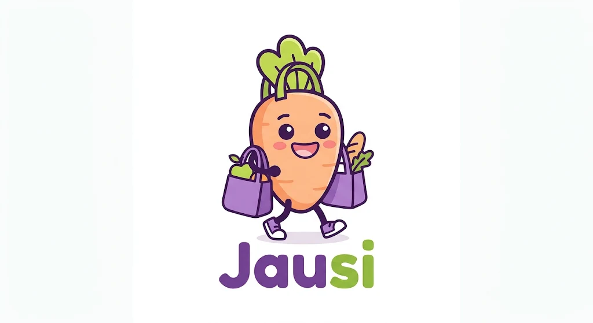
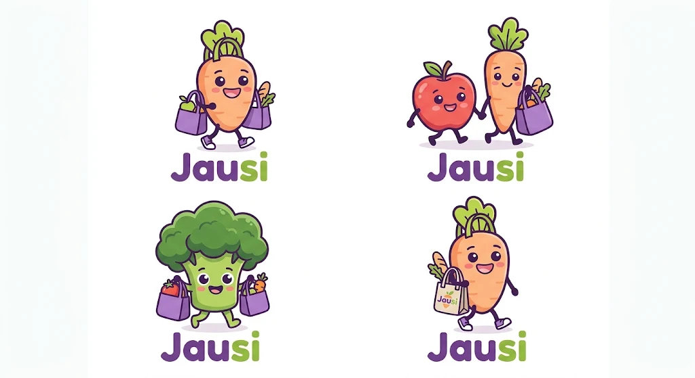
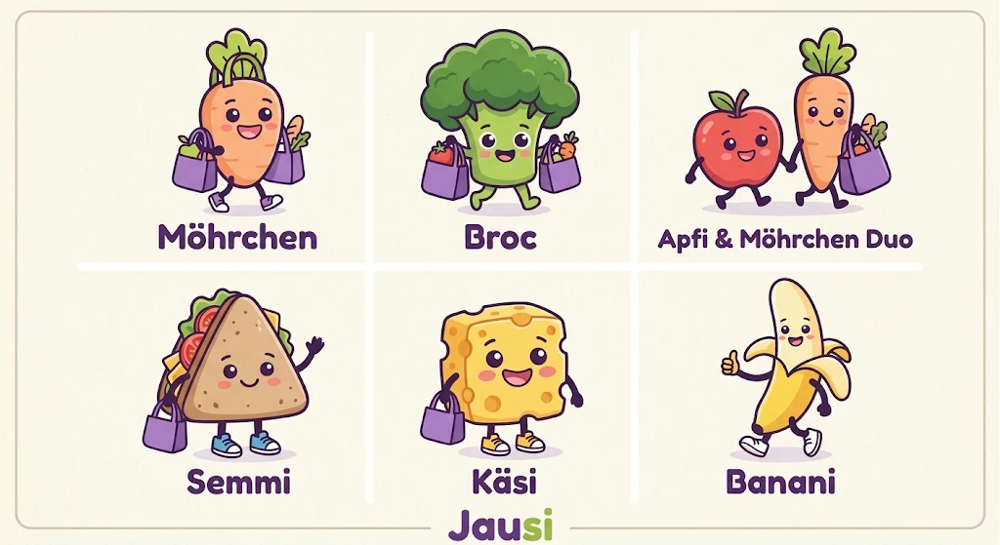

# Branding und Maskottchen (Idee)

**Status:** Idee. Die vorbereitete [Hosting-Willkommensseite](azure-hosting.md) nutzt den Möhrchen-Entwurf als Vorschau. Über die Verwendung in der App und das endgültige Logo entscheidet das Team. Beides gehört nicht zum MVP-Scope.

Die Bilder und Figurenbeschreibungen wurden mit Google Gemini erzeugt und von Roger am 09.11.2026 eingebracht (siehe [AI-Einsatz](ai-usage.md)).

## Logo-Entwürfe

*Hauptentwurf: Möhrchen mit zwei violetten Einkaufstaschen, Schriftzug „Jau“ in Violett, „si“ in Grün.*

*Varianten: Möhrchen allein, Apfel-und-Möhrchen-Duo, Brokkoli, Möhrchen mit Jausi-Stofftasche.*

## Figurenfamilie

| Figur | Aussehen | Haltung | Wirkung | Bild vorhanden |
| --- | --- | --- | --- | --- |
| Möhrchen (Karotte) | Orange Karotte mit grünem Laub | Trägt zwei violette Taschen | Hauptfigur des Logos | Ja |
| Broc (Brokkoli) | Grüner Brokkoli | Trägt zwei violette Taschen | Frisch, Gemüse | Ja |
| Apfi (Apfel) | Runder roter Apfel mit glänzendem Lichtpunkt, grünem Blatt, rosa Wangen | Geht Hand in Hand mit Möhrchen; alternativ Papiertüte über der Schulter oder Daumen hoch | Energiegeladen, frisch – Obst und Frühstück | Ja (im Duo) |
| Semmi (Jausenbrot) | Dreieckiges Vollkornbrot mit Salat, Käse und Tomate | Winkt; alternativ mit Saftpackerl oder Mini-Rucksack | Klassische österreichische Jause | Ja |
| Käsi (Käse) | Gelber Emmentaler-Block mit abgerundeten Kanten und Löchern | Trägt eine violette Tasche; alternativ mit Weintrauben | Verspielt, gemütlich – Milchprodukte, Pikantes | Ja |
| Banani (Banane) | Halb geschälte, gebogene Banane mit weißen Sneakers | Daumen hoch; alternativ winkend mit Mehrwegtasche | Schnelle Energie, sportlich | Ja |
| Brezi (Brezel) | Goldbraune Brezel mit weißen Salzkörnern, großen runden Augen | Arme verschränkt oder Hand in Hand mit Semmi oder Apfi | Traditionell, bäckerfrisch | Nein |
| Peri (Birne) | Tropfenförmige grün-gelbe Birne mit sanftem Ausdruck | Geht mit der Heidelbeere Hand in Hand | Frucht-Geschwister | Nein |
| Heidelbeere (Name offen) | Kleine runde Beere als Begleiterin | Läuft neben Peri oder sitzt in Peris Tasche | Frucht-Geschwister | Nein |

## Gestaltungsregeln

- **Stil:** Kawaii-Vektorstil mit runden Formen, ausdrucksstarken Gesichtern und kräftigen Farben.
- **Konturen:** Dicke, leicht abgerundete dunkelviolette oder braune Linien statt reinem Schwarz.
- **Farben:** Violett `#6B4C9A` für Taschen und Schriftzug, Grün `#88C13F` für Akzente.
- **Accessoires:** Violette Mehrweg-Einkaufstaschen als wiederkehrendes Element.
- **Details:** Weiße Sneakers mit farbigen Sohlen, rosa Wangen.

## Offene Punkte

- **Namenskonflikt Apfel:** Die AI-Beschreibung nennt den Apfel „Anton“, das Bild „Apfi“. Hier wird „Apfi“ verwendet, passend zum Namensmuster (Semmi, Käsi, Banani).
- **Name der Heidelbeere:** Der AI-Vorschlag „Bluey“ ist bereits Titel einer bekannten Kinderserie und wird deshalb nicht übernommen. Ein eigener Name ist offen.
- **Nutzungsrechte:** Die Nutzungsbedingungen von Gemini sind vor einer Verwendung über das Semesterprojekt hinaus zu prüfen.
- **Verwendung:** Ob die Figuren in der App erscheinen und welche das Logo bildet, entscheidet das Team, sobald es um das Design geht.
