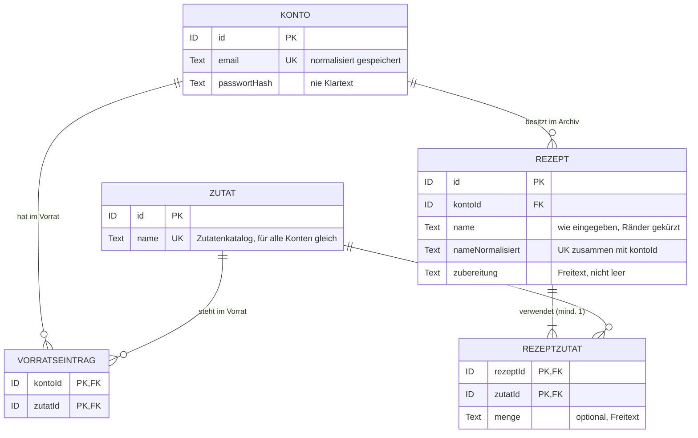

# Datenmodell

> [!NOTE]
> **Entwurf (Phase 2), Stand 13.11.2026**, mit AI erarbeitet, vom Team noch nicht geprüft. Grundlage: [Begriffe](requirements.md#begriffe) und [Architektur](architecture.md). Typen technologieneutral; Schnittstellen in [api.md](api.md).

Das Modell enthält nur den MVP-Umfang aus [mvp.md](mvp.md). Vorrat und Rezeptarchiv sind keine eigenen Tabellen: Der Vorrat eines Kontos ist die Menge seiner Vorratseinträge, das Rezeptarchiv die Menge seiner Rezepte.

## Entitäten

**Konto** · FR-16, US-23, US-24, US-26, NFR-06

| Attribut | Typ | Schlüssel und Regeln |
| --- | --- | --- |
| id | ID | Primärschlüssel, vom Server vergeben |
| email | Text | Pflicht, gültige E-Mail-Adresse. Wird beim Registrieren und beim Anmelden gleich normalisiert: Leerzeichen am Rand entfernt, in Kleinbuchstaben. Gespeichert wird nur die normalisierte Form mit Unique-Schlüssel; dadurch ist sie eindeutig ohne Beachtung der Groß-/Kleinschreibung (US-23 AK 2). |
| passwortHash | Text | Pflicht; gespeichert wird nur der Hash, den der Anmeldebaustein des Frameworks erzeugt, nie das Passwort (NFR-06). Das Passwort hat mindestens 8 Zeichen; geprüft wird vor dem Hashen. |

Weitere personenbezogene Daten werden nicht erfasst (NFR-06). Sitzungen verwaltet der Anmeldebaustein des Frameworks.

**Löschen** eines Kontos (US-26) entfernt in einer Transaktion per Kaskade alle Vorratseinträge, Rezepte und Rezeptzutaten sowie alle Sitzungen des Kontos; der Katalog bleibt. Das ist die bewusste Ausnahme von der [Modulregel](architecture.md#komponenten-und-verantwortlichkeiten), damit kein Rest übrig bleibt. In Sicherungen des Hosting-Anbieters bleiben die Daten bis zum Ablauf der Aufbewahrungsfrist; das gehört in die Datenschutzerklärung (US-31).

**Zutat** (Zutatenkatalog) · FR-01, US-01, US-04, US-13

| Attribut | Typ | Schlüssel und Regeln |
| --- | --- | --- |
| id | ID | Primärschlüssel |
| name | Text | Pflicht, nicht leer, eindeutig ohne Beachtung der Groß-/Kleinschreibung und der Leerzeichen am Rand; genau eine Schreibweise je Zutat |

Der Katalog gehört keinem Konto. Das Team pflegt ihn von Hand als Startdaten des Programms in [zutatenkatalog.csv](zutatenkatalog.csv); Nutzer können über die API nichts daran ändern. Regeln für neue Einträge: Bezeichnung wie im österreichischen Alltag (Erdäpfel, Topfen, aber Tomate), Singular außer bei üblichem Plural, nur unterscheiden, was beim Kochen nicht austauschbar ist. Die Spalte „gruppe“ dient nur der Übersicht. Eine Zutat, die in einem Vorratseintrag oder einer Rezeptzutat vorkommt, darf nicht gelöscht werden (Fremdschlüssel ohne Kaskade); ein Rezept zu löschen lässt seine Zutaten im Katalog (US-19 AK 2).

**Vorratseintrag** · FR-02, US-01–03

| Attribut | Typ | Schlüssel und Regeln |
| --- | --- | --- |
| kontoId | ID | Teil des Primärschlüssels, Fremdschlüssel auf Konto, Kaskade beim Löschen des Kontos |
| zutatId | ID | Teil des Primärschlüssels, Fremdschlüssel auf Zutat |

Der zusammengesetzte Schlüssel stellt sicher, dass jede Zutat höchstens einmal im Vorrat steht (US-01 AK 2). Mengen gibt es bewusst nicht (Mengenvergleich außerhalb des MVP).

**Rezept** · FR-03, US-04–06, US-19

| Attribut | Typ | Schlüssel und Regeln |
| --- | --- | --- |
| id | ID | Primärschlüssel |
| kontoId | ID | Fremdschlüssel auf Konto, Pflicht, Kaskade beim Löschen des Kontos |
| name | Text | Pflicht, nicht leer; gespeichert wie eingegeben, aber ohne Leerzeichen am Rand (Anzeige) |
| nameNormalisiert | Text | Pflicht; vom Server aus `name` abgeleitet: ohne Leerzeichen am Rand, in Kleinbuchstaben. **Unique-Schlüssel auf (kontoId, nameNormalisiert)**: ein Rezeptname höchstens einmal je Konto, ohne Beachtung der Groß-/Kleinschreibung (US-04 AK 3). Wird bei jeder Namensänderung neu berechnet. |
| zubereitung | Text | Pflicht, nicht leer und nicht nur Leerzeichen (Freitext) |

Ein Rezept hat **mindestens eine** Rezeptzutat (US-04 AK 2). Diese Regel prüft die Anwendung beim Speichern, weil eine Datenbank sie nicht einfach erzwingen kann. Anlegen und Bearbeiten speichern Rezept und Rezeptzutaten in einer Transaktion. Löschen entfernt seine Rezeptzutaten mit (Kaskade).

**Rezeptzutat** · FR-03, US-04, US-06

| Attribut | Typ | Schlüssel und Regeln |
| --- | --- | --- |
| rezeptId | ID | Teil des Primärschlüssels, Fremdschlüssel auf Rezept, Kaskade beim Löschen des Rezepts |
| zutatId | ID | Teil des Primärschlüssels, Fremdschlüssel auf Zutat |
| menge | Text | optional, Freitext für Menge und Hinweise ([fachliche Regeln](requirements.md#fachliche-regeln)); zählt nicht fürs Matching (US-08 AK 2) |

Der zusammengesetzte Schlüssel stellt sicher, dass jede Zutat höchstens einmal in einem Rezept steht (US-04 AK 4).

**Matching** (FR-05, US-08, US-09) speichert nichts. Es berechnet die fehlenden Zutaten bei jeder Abfrage aus Rezeptzutaten und Vorratseinträgen desselben Kontos (siehe [api.md](api.md#matching)).

## Nach dem MVP (Should/Could)

Should- und Could-Stories außerhalb des MVP, hier nicht im Detail modelliert; so würden sie hineinpassen. Funktionen mit der Priorität „Später“ (nach dem Kurs) sind bewusst nicht berücksichtigt.

- **Einkaufsliste** (US-12, US-20, Could): eigene Entität wie Vorratseintrag, Konto × Zutat ohne Menge; Abhaken verschiebt den Eintrag in den Vorrat.
- **Notiz zum Vorrat** (US-33, Should): optionales Textattribut `notiz` am Vorratseintrag; zählt nicht fürs Matching.
- **Favorit** (US-11, Could): ein Ja/Nein-Attribut am Rezept.
- **Kategorie** (US-21, US-22, Could): eigene Entität je Konto; Rezept bekommt einen optionalen Verweis darauf, Zutaten eine Zuordnung Konto × Zutat, weil der Katalog für alle Konten gleich ist.
- **Eigene Zutaten** (US-17, US-18, Should): Zutat bekommt einen optionalen Verweis auf das anlegende Konto; leer bedeutet Katalog für alle. Die Eindeutigkeit gilt dann je Konto zusammen mit dem Katalog.
