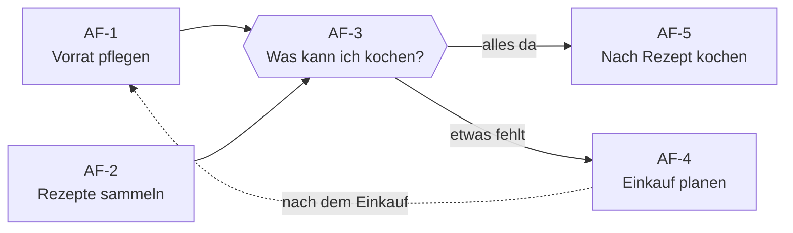
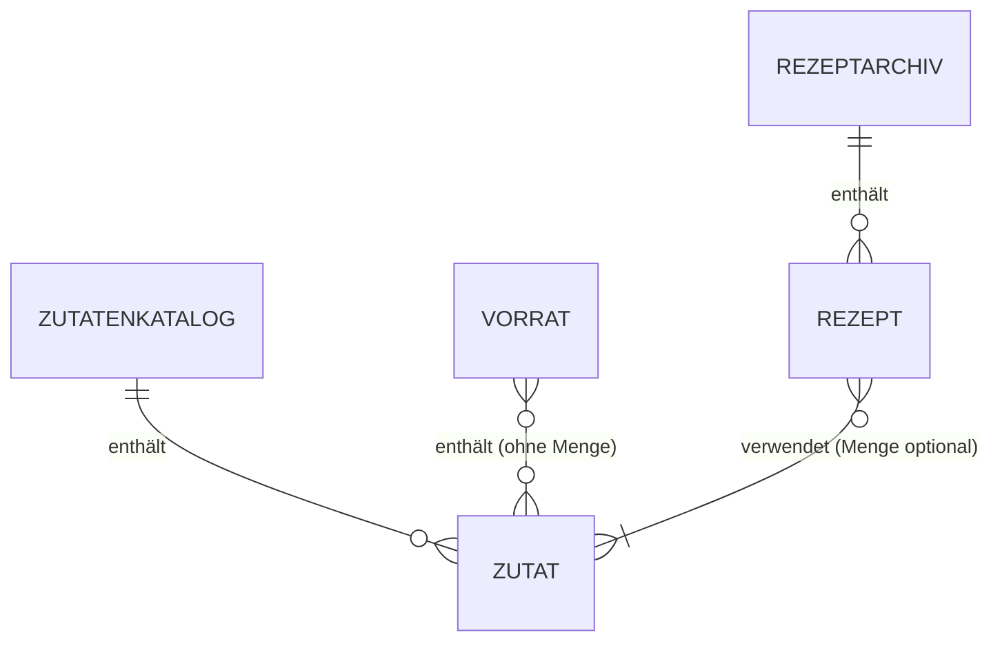

# Anforderungen und User Stories

> [!NOTE]
> Arbeitsentwurf. Mehrere Vorschläge vom 09.11.2026 muss das Team noch bestätigen; die Agenda steht in [mvp.md](mvp.md#noch-in-phase-1-klären).

**Inhalt:** [Kontext](#kontext) · [Anwendungsfälle](#wichtigste-anwendungsfälle) · [Begriffe](#begriffe) · [Fachliche Regeln](#fachliche-regeln) · [User Stories](#user-stories-mit-akzeptanzkriterien) · [Funktionale Anforderungen](#funktionale-anforderungen) · [Nichtfunktionale Anforderungen](#nichtfunktionale-anforderungen) · [Einschränkungen und Risiken](#bekannte-einschränkungen-und-risiken)

## Kontext

- **Produkt:** Jausi verbindet Lebensmittelvorrat und persönliches Rezeptarchiv und zeigt, was mit vorhandenen Zutaten kochbar ist. Problem und Zahlen stehen im [README](../README.md).
- **Zielgruppe:** Menschen, die mit vorhandenen Zutaten kochen möchten, primär Studierende. Die Personas Lena (primär), Andrea und Jonas stehen in [personas.md](personas.md). „Nutzer“ in den Stories meint alle Personas.
- **Nutzung:** hauptsächlich auf dem Smartphone, in der Küche (Was kann ich kochen? Rezept lesen) und beim Einkaufen (Was fehlt? Vorrat ergänzen). Die App ist vollständig auf dem Smartphone bedienbar, auch ohne Internet.
- **Rahmen:** Semesterprojekt eines vierköpfigen Teams mit kleinem MVP. Ob native App oder Web-App, entscheidet Phase 2.

## Wichtigste Anwendungsfälle

Jeder Anwendungsfall beschreibt, wer wann warum handelt und was danach gilt. Jede User Story gehört zu mindestens einem Anwendungsfall.

| ID | Anwendungsfall | Persona | Auslöser | Ergebnis | User Stories | Im MVP |
| --- | --- | --- | --- | --- | --- | --- |
| AF-1 | Vorrat pflegen | alle | nach dem Einkauf oder Kochen | Der Vorrat stimmt mit den Zutaten daheim überein. | US-01–03, US-13–15, US-17, US-18, US-21 | Teilweise (nur Must-Stories) |
| AF-2 | Rezepte sammeln | Jonas | ein neues Gericht gekocht oder entdeckt | Das Rezept ist im Archiv und wiederauffindbar. | US-04–07, US-11, US-13, US-17–19, US-22 | Teilweise (nur Must-Stories) |
| AF-3 | Was kann ich kochen? | Lena | Hunger, Blick in den Kühlschrank | Ein Rezept ist gewählt, dessen Zutaten alle vorhanden sind. | US-08, US-09 | Ja, vollständig (Hauptanwendungsfall) |
| AF-4 | Einkauf planen | Andrea | vor dem Wocheneinkauf | Sie weiß, welche Zutaten sie für welche Rezepte nachkaufen muss. | US-09, US-10, US-12, US-20 | Teilweise (nur Must-Story US-09) |
| AF-5 | Nach Rezept kochen | alle | am Herd, Smartphone in der Hand | Das Gericht ist zubereitet, ohne lange im Rezept zu suchen. | US-05, US-16 | Teilweise (nur Must-Story US-05) |

AF-1 und AF-2 sind die Voraussetzung für den Hauptanwendungsfall AF-3:

## Begriffe

Die Begriffe gelten verbindlich für alle Projektdokumente; wörtliche Zitate in [ai-usage.md](ai-usage.md) bleiben unverändert.

| Begriff | Bedeutung | Nicht verwenden |
| --- | --- | --- |
| **Zutatenkatalog** | Persönliche Liste aller Zutaten mit genau einer Schreibweise je Zutat. Startet leer und wächst mit jeder neuen Zutat. Vorrat und Rezepte verwenden nur Zutaten daraus. | Zutatenliste |
| **Vorrat** | Zutaten aus dem Katalog, die gerade daheim sind, ohne Mengen. | Bestand, Vorratsliste, Inventur, Inventurliste |
| **Rezept** | Name, mindestens eine Zutat und eine Zubereitung als Freitext; Mengen sind optional und Freitext. | – |
| **Rezeptarchiv** (kurz: Archiv) | Alle gespeicherten Rezepte. | Rezeptliste, Rezeptsammlung |
| **Zutatenvorschlag** | Zutat aus dem Katalog, die beim Eintippen angezeigt wird (US-13). Nicht dasselbe wie Matching. | – |
| **Matching** | Abgleich eines Rezepts mit dem Vorrat: Welche Zutaten sind da, welche fehlen? Mengen zählen nicht. | Rezeptvorschlag |
| **Vollständig passendes Rezept** | Alle Zutaten des Rezepts stehen im Vorrat. | – |
| **Fehlende Zutat** | Zutat eines Rezepts, die nicht im Vorrat steht. | – |
| **Favorit** | Vom Nutzer markiertes Rezept (Could). | Lieblingsrezept |
| **Einkaufsliste** | Zutaten aus dem Katalog, die der Nutzer kaufen will (Could). Abgehakte Zutaten wandern in den Vorrat. | Shoppingliste |
| **Kategorie** | Vom Nutzer selbst angelegte Gruppe für Zutaten oder Rezepte, etwa „Gemüse“ oder „Frühstück“ (Could). | Tag, Label |

## Fachliche Regeln

**Zutaten**
- Vorrat und Rezepte verwenden nur Zutaten aus dem Zutatenkatalog.
- Beim Tippen werden alle Zutaten vorgeschlagen, deren Name die Eingabe enthält, ohne Beachtung der Groß-/Kleinschreibung und alphabetisch sortiert.
- Fehlt eine Zutat, wird sie neu angelegt, direkt dort übernommen, wo sie eingegeben wurde (Vorrat oder Rezept), und steht danach überall zur Auswahl.
- Namen, die sich nur in Groß-/Kleinschreibung oder in Leerzeichen am Rand unterscheiden, gelten als gleich. Dann wird die vorhandene Zutat verwendet; die zuerst eingegebene Schreibweise bleibt.
- Ein Zutatenname darf nicht leer sein und nicht nur aus Leerzeichen bestehen.

**Vorrat**
- Jede Zutat steht höchstens einmal im Vorrat; was nicht darin steht, gilt als nicht vorhanden. Mengen werden nicht erfasst.
- Salz, Öl und andere Grundzutaten werden wie alle Zutaten behandelt und nicht automatisch als vorhanden angenommen.

**Rezepte**
- Ein Rezept ist gültig mit Name, mindestens einer Zutat und einer nicht leeren Zubereitung (Freitext).
- Jede Zutat steht höchstens einmal in einem Rezept; erneutes Hinzufügen zeigt einen Hinweis.
- Rezeptnamen sind eindeutig, nach derselben Regel wie Zutatennamen.
- Mengen sind optional und werden je Zutat als Freitext erfasst, etwa „500 g“ oder „1 Prise“.

**Anzeige und Speichern**
- Vorrat und Archiv sind alphabetisch sortiert, ohne Beachtung der Groß-/Kleinschreibung.
- Das Archiv zeigt bei jedem Rezept, ob alle Zutaten vorhanden sind oder wie viele fehlen.
- Änderungen am Vorrat werden sofort gespeichert. Rezepte werden mit „Speichern“ gesichert; wer ein Rezept mit ungespeicherten Änderungen verlässt, bekommt eine Sicherheitsabfrage.

**Matching**
- Ein Rezept passt vollständig, wenn alle seine Zutaten im Vorrat stehen. Mengen werden nicht geprüft.
- Änderungen am Vorrat ändern keine Rezepte; das Matching verwendet immer den aktuellen Vorrat.

**Einkaufsliste (Could)**
- Die Einkaufsliste enthält nur Zutaten aus dem Zutatenkatalog.
- Abgehakte Zutaten werden in den Vorrat übernommen und von der Liste entfernt.

## User Stories mit Akzeptanzkriterien

Die Stories sind nach Anwendungsfall gruppiert. Ein Klick klappt eine Story mit ihren Akzeptanzkriterien (AK) im Format Gegeben / Wenn / Dann auf. Hinweistexte dürfen im Design (Phase 2) umformuliert werden; ihre Aussage bleibt gleich.

### Story Map

**Must** ist nötig für den Kernablauf: Zutaten erfassen, Rezepte verwalten, passende Rezepte und fehlende Zutaten sehen, alles dauerhaft gespeichert, auf dem Smartphone auch offline. Die Must-Zeile ist der MVP. **Should** verbessert die Nutzung, **Could** ist Komfort.

| | 🥕 AF-1 Vorrat pflegen | 📖 AF-2 Rezepte sammeln | 🍳 AF-3 Was kann ich kochen? | 🛒 AF-4 Einkauf planen | 👩‍🍳 AF-5 Nach Rezept kochen |
| --- | --- | --- | --- | --- | --- |
| **Must** | [US-01](#us-01) [US-02](#us-02) [US-03](#us-03) [US-13](#us-13) [US-17](#us-17) [US-18](#us-18) | [US-04](#us-04) [US-05](#us-05) [US-06](#us-06) [US-19](#us-19) | [US-08](#us-08) [US-09](#us-09) | – | – |
| **Should** | [US-14](#us-14) | [US-07](#us-07) | – | [US-10](#us-10) | – |
| **Could** | [US-15](#us-15) [US-21](#us-21) | [US-11](#us-11) [US-22](#us-22) | – | [US-12](#us-12) [US-20](#us-20) | [US-16](#us-16) |

### 🥕 AF-1 · Vorrat pflegen

<strong>US-01 · Zutat zum Vorrat hinzufügen</strong> · Must

> Als Nutzer möchte ich eine Zutat aus dem Zutatenkatalog zum Vorrat hinzufügen, damit Jausi weiß, welche Rezepte ich kochen kann.

**Akzeptanzkriterien**

**AK 1**
- **Gegeben** „Reis“ steht im Zutatenkatalog, aber nicht im Vorrat
- **Wenn** die Person „Reis“ zum Vorrat hinzufügt
- **Dann** steht „Reis“ im Vorrat.

**AK 2**
- **Gegeben** „Reis“ steht bereits im Vorrat
- **Wenn** die Person „Reis“ erneut hinzufügt
- **Dann** steht „Reis“ weiterhin genau einmal im Vorrat.

**AK 3**
- **Gegeben** die Person hat „Reis“ zum Vorrat hinzugefügt
- **Wenn** sie die App sofort danach schließt und neu startet
- **Dann** steht „Reis“ im Vorrat, ohne dass sie etwas speichern musste.

<strong>US-02 · Vorrat anzeigen</strong> · Must

> Als Nutzer möchte ich meinen Vorrat sehen, damit ich vorhandene Lebensmittel überblicken kann.

**Akzeptanzkriterien**

**AK 1**
- **Gegeben** der Vorrat enthält Tomate und Reis
- **Wenn** die Person den Vorrat öffnet
- **Dann** werden genau Reis und Tomate angezeigt, in dieser Reihenfolge (alphabetisch).

**AK 2**
- **Gegeben** der Vorrat ist leer
- **Wenn** die Person den Vorrat öffnet
- **Dann** erscheint der Hinweis „Noch keine Zutaten im Vorrat“, und das Hinzufügen einer Zutat ist mit einem Tipp erreichbar.

<strong>US-03 · Zutat aus dem Vorrat entfernen</strong> · Must

> Als Nutzer möchte ich verbrauchte Zutaten entfernen, damit mein Vorrat aktuell bleibt.

**Akzeptanzkriterien**

**AK 1**
- **Gegeben** Tomate steht im Vorrat und im Rezept „Tomatenreis“
- **Wenn** die Person Tomate aus dem Vorrat entfernt
- **Dann** steht Tomate nicht mehr im Vorrat, das Rezept „Tomatenreis“ bleibt unverändert und zeigt Tomate als fehlende Zutat.

**AK 2**
- **Gegeben** Tomate steht im Vorrat
- **Wenn** die Person Tomate entfernt
- **Dann** geschieht das sofort, ohne Sicherheitsabfrage.

<strong>US-13 · Zutatenvorschläge beim Tippen</strong> · Must

> Als Nutzer möchte ich beim Eintippen einer Zutat passende Zutaten aus meinem Zutatenkatalog vorgeschlagen bekommen, damit ich schnell auswähle, statt neu zu tippen.

*Gehört auch zu AF-2.*

**Akzeptanzkriterien**

**AK 1**
- **Gegeben** „Reis“ und „Paprika“ stehen im Zutatenkatalog
- **Wenn** die Person „RE“ eintippt
- **Dann** wird „Reis“ vorgeschlagen und „Paprika“ nicht.

**AK 2**
- **Gegeben** „Reis“ wird vorgeschlagen
- **Wenn** die Person den Vorschlag wählt
- **Dann** wird „Reis“ übernommen, ohne dass eine neue Zutat entsteht.

**AK 3**
- **Gegeben** „Reis“ und „Eis“ stehen im Zutatenkatalog
- **Wenn** die Person „eis“ eintippt
- **Dann** werden „Eis“ und „Reis“ in dieser Reihenfolge vorgeschlagen, weil beide „eis“ enthalten.

<strong>US-17 · Neue Zutat anlegen</strong> · Must

> Als Nutzer möchte ich eine Zutat neu anlegen, wenn sie noch nicht im Zutatenkatalog steht, damit ich alle Zutaten meiner eigenen Rezepte verwenden kann.

*Gehört auch zu AF-2.*

**Akzeptanzkriterien**

**AK 1**
- **Gegeben** „Ei“ steht nicht im Zutatenkatalog
- **Wenn** die Person im Vorrat „Ei“ eintippt und neu anlegt
- **Dann** steht „Ei“ im Zutatenkatalog und im Vorrat und ist auch in Rezepten auswählbar.

**AK 2**
- **Gegeben** „Ei“ steht nicht im Zutatenkatalog
- **Wenn** die Person beim Anlegen eines Rezepts „Ei“ eintippt und neu anlegt
- **Dann** steht „Ei“ im Zutatenkatalog und im Rezept, aber nicht im Vorrat.

**AK 3**
- **Gegeben** die Eingabe ist leer oder besteht nur aus Leerzeichen
- **Wenn** die Person eine Zutat anlegen will
- **Dann** wird keine Zutat angelegt, und ein Hinweis erscheint.

<strong>US-18 · Doppelte Zutaten verhindern</strong> · Must

> Als Nutzer möchte ich, dass Jausi doppelte Zutaten verhindert, damit das Matching nicht an unterschiedlichen Schreibweisen scheitert.

*Gehört auch zu AF-2.*

**Akzeptanzkriterien**

**AK 1**
- **Gegeben** „Reis“ steht im Zutatenkatalog
- **Wenn** die Person „ reis “ neu anlegen will
- **Dann** wird keine neue Zutat angelegt, sondern „Reis“ verwendet.

**AK 2**
- **Gegeben** „Tomate“ steht im Zutatenkatalog
- **Wenn** die Person „Tomaten“ anlegt
- **Dann** entsteht eine zweite Zutat. Das ist die dokumentierte Einschränkung bei Pluralformen.

<strong>US-14 · Zutaten umbenennen oder zusammenführen</strong> · Should

> Als Nutzer möchte ich Zutaten umbenennen oder zusammenführen, damit ich Tippfehler und Duplikate korrigieren kann.

**Akzeptanzkriterien**

**AK 1**
- **Gegeben** „Tomatte“ steht im Vorrat und im Rezept „Tomatenreis“
- **Wenn** die Person sie in „Tomate“ umbenennt
- **Dann** erscheint „Tomate“ in Vorrat und Rezept.

**AK 2**
- **Gegeben** „Tomate“ und „Tomaten“ existieren
- **Wenn** die Person „Tomaten“ mit „Tomate“ zusammenführt
- **Dann** verweisen Vorrat und alle Rezepte nur noch auf „Tomate“, und „Tomaten“ ist nicht mehr im Zutatenkatalog.

**AK 3**
- **Gegeben** ein Rezept enthält sowohl „Tomate“ als auch „Tomaten“
- **Wenn** die Person „Tomaten“ mit „Tomate“ zusammenführt
- **Dann** steht „Tomate“ genau einmal im Rezept.

<strong>US-15 · Unbenutzte Zutaten löschen</strong> · Could

> Als Nutzer möchte ich unbenutzte Zutaten löschen, damit der Zutatenkatalog übersichtlich bleibt.

**Akzeptanzkriterien**

**AK 1**
- **Gegeben** „Zimt“ kommt weder im Vorrat noch in einem Rezept vor
- **Wenn** die Person „Zimt“ löscht und die Sicherheitsabfrage bestätigt
- **Dann** ist „Zimt“ nicht mehr im Zutatenkatalog.

**AK 2**
- **Gegeben** „Reis“ kommt in einem Rezept vor
- **Wenn** die Person „Reis“ löschen will
- **Dann** ist das nicht möglich, und ein Hinweis nennt den Grund.

<strong>US-21 · Zutaten kategorisieren</strong> · Could

> Als Nutzer möchte ich Zutaten einer Kategorie wie „Gemüse“ oder „Milchprodukte“ zuordnen und den Vorrat danach filtern, damit ich bei vielen Zutaten den Überblick behalte.

**Akzeptanzkriterien**

**AK 1**
- **Gegeben** Tomate gehört zur Kategorie „Gemüse“, Milch zu „Milchprodukte“, beide stehen im Vorrat
- **Wenn** die Person den Vorrat nach „Gemüse“ filtert
- **Dann** wird nur Tomate angezeigt.

**AK 2**
- **Gegeben** eine Zutat ohne Kategorie
- **Wenn** die Person sie zum Vorrat hinzufügt
- **Dann** ist das möglich; die Kategorie ist optional.

**AK 3**
- **Gegeben** es gibt noch keine Kategorie „Gewürze“
- **Wenn** die Person bei Zimt „Gewürze“ eingibt
- **Dann** wird die Kategorie angelegt und steht danach für weitere Zutaten zur Auswahl.

### 📖 AF-2 · Rezepte sammeln

<strong>US-04 · Rezept anlegen</strong> · Must

> Als Nutzer möchte ich ein Rezept anlegen, damit ich es später wieder verwenden kann.

**Akzeptanzkriterien**

**AK 1**
- **Gegeben** es gibt kein Rezept „Tomatenreis“
- **Wenn** die Person ein Rezept mit dem Namen „Tomatenreis“, den Zutaten Reis und Tomate und einer Zubereitung speichert
- **Dann** erscheint es im Archiv.

**AK 2**
- **Gegeben** Name, Zutaten oder Zubereitung fehlen
- **Wenn** die Person speichert
- **Dann** wird nicht gespeichert, und eine Fehlermeldung nennt das fehlende Feld.

**AK 3**
- **Gegeben** es gibt bereits „Tomatenreis“
- **Wenn** die Person ein neues Rezept „tomatenreis“ speichert
- **Dann** wird nicht gespeichert, und eine Fehlermeldung weist auf den vorhandenen Namen hin.

**AK 4**
- **Gegeben** Reis steht bereits im Rezept
- **Wenn** die Person Reis erneut hinzufügt
- **Dann** erscheint ein Hinweis, und Reis steht weiterhin genau einmal im Rezept.

<strong>US-05 · Archiv und Rezept öffnen</strong> · Must

> Als Nutzer möchte ich das Rezeptarchiv und einzelne Rezepte öffnen, damit ich Zutaten und Zubereitung lesen kann.

*Gehört auch zu AF-5.*

**Akzeptanzkriterien**

**AK 1**
- **Gegeben** das Archiv enthält „Tomatenreis“ und „Eierreis“
- **Wenn** die Person das Archiv öffnet
- **Dann** werden beide Rezepte mit Namen angezeigt, alphabetisch sortiert („Eierreis“ vor „Tomatenreis“).

**AK 2**
- **Gegeben** ein Rezept mit Zutaten, Mengenangaben und Zubereitung
- **Wenn** die Person es öffnet
- **Dann** werden alle erfassten Angaben angezeigt.

**AK 3**
- **Gegeben** das Archiv ist leer
- **Wenn** die Person es öffnet
- **Dann** erscheint der Hinweis „Noch keine Rezepte“, und das Anlegen eines Rezepts ist mit einem Tipp erreichbar.

<strong>US-06 · Rezept bearbeiten</strong> · Must

> Als Nutzer möchte ich ein Rezept bearbeiten, damit ich Korrekturen und Änderungen festhalten kann.

**Akzeptanzkriterien**

**AK 1**
- **Gegeben** ein gespeichertes Rezept
- **Wenn** die Person die Zubereitung ändert und speichert
- **Dann** ist die Änderung nach erneutem Öffnen sichtbar.

**AK 2**
- **Gegeben** „Tomatenreis“ enthält Reis und Tomate
- **Wenn** die Person Tomate entfernt, Zwiebel hinzufügt, bei Reis die Menge „200 g“ einträgt und speichert
- **Dann** enthält das Rezept nach erneutem Öffnen Reis (200 g) und Zwiebel.

**AK 3**
- **Gegeben** die Änderung verletzt eine Regel aus US-04, etwa ein leerer Name
- **Wenn** die Person speichert
- **Dann** wird nicht gespeichert, und eine Fehlermeldung erscheint.

**AK 4**
- **Gegeben** die Person hat die Zubereitung geändert, aber nicht gespeichert
- **Wenn** sie das Rezept verlässt
- **Dann** erscheint eine Sicherheitsabfrage; bestätigt sie, wird die Änderung verworfen, bricht sie ab, bleibt sie im Rezept.

<strong>US-19 · Rezept löschen</strong> · Must

> Als Nutzer möchte ich ein Rezept löschen, damit mein Archiv nur Rezepte enthält, die ich noch nutze.

**Akzeptanzkriterien**

**AK 1**
- **Gegeben** ein gespeichertes Rezept
- **Wenn** die Person „Löschen“ wählt
- **Dann** erscheint eine Sicherheitsabfrage.

**AK 2**
- **Gegeben** die Sicherheitsabfrage
- **Wenn** die Person bestätigt
- **Dann** ist das Rezept nicht mehr im Archiv, und seine Zutaten bleiben im Zutatenkatalog.

**AK 3**
- **Gegeben** die Sicherheitsabfrage
- **Wenn** die Person abbricht
- **Dann** bleibt das Rezept unverändert im Archiv.

<strong>US-07 · Rezepte suchen</strong> · Should

> Als Nutzer möchte ich Rezepte nach Namen suchen, damit ich ein bestimmtes Gericht finde.

**Akzeptanzkriterien**

**AK 1**
- **Gegeben** das Archiv enthält „Tomatenreis“ und „Eierreis“
- **Wenn** die Person „REIS“ sucht
- **Dann** werden beide Rezepte angezeigt.

**AK 2**
- **Gegeben** kein Rezeptname enthält den Suchbegriff
- **Wenn** die Person sucht
- **Dann** erscheint der Hinweis „Keine Rezepte gefunden“.

<strong>US-11 · Favoriten</strong> · Could

> Als Nutzer möchte ich Rezepte als Favoriten markieren, damit ich sie schnell wiederfinde.

**Akzeptanzkriterien**

**AK 1**
- **Gegeben** ein Rezept ist kein Favorit
- **Wenn** die Person es als Favorit markiert
- **Dann** erscheint es im Favoritenfilter.

**AK 2**
- **Gegeben** ein Rezept ist Favorit
- **Wenn** die Person die Markierung entfernt
- **Dann** erscheint es nicht mehr im Favoritenfilter.

<strong>US-22 · Rezepte kategorisieren</strong> · Could

> Als Nutzer möchte ich Rezepte einer Kategorie wie „Frühstück“ oder „Hauptspeise“ zuordnen und das Archiv danach filtern, damit ich passende Gerichte schneller finde.

**Akzeptanzkriterien**

**AK 1**
- **Gegeben** „Eierreis“ gehört zu „Hauptspeise“, „Porridge“ zu „Frühstück“
- **Wenn** die Person das Archiv nach „Frühstück“ filtert
- **Dann** wird nur „Porridge“ angezeigt.

**AK 2**
- **Gegeben** ein Rezept ohne Kategorie
- **Wenn** die Person es speichert
- **Dann** ist es gültig; die Kategorie ist optional.

**AK 3**
- **Gegeben** es gibt noch keine Kategorie „Dessert“
- **Wenn** die Person bei einem Rezept „Dessert“ eingibt
- **Dann** wird die Kategorie angelegt und steht danach für weitere Rezepte zur Auswahl.

### 🍳 AF-3 · Was kann ich kochen?

<strong>US-08 · Vollständig passende Rezepte anzeigen</strong> · Must

> Als Nutzerin wie Lena möchte ich vollständig passende Rezepte anzeigen, damit ich ohne Einkauf schnell etwas kochen kann.

**Akzeptanzkriterien**

**AK 1**
- **Gegeben** der Vorrat enthält Reis und Tomate, das Archiv „Tomatenreis“ (Reis, Tomate) und „Eierreis“ (Reis, Ei)
- **Wenn** die Person den Filter für vollständig passende Rezepte wählt
- **Dann** wird nur „Tomatenreis“ angezeigt.

**AK 2**
- **Gegeben** ein Rezept verlangt „500 g Reis“ und Reis steht im Vorrat
- **Wenn** das Matching läuft
- **Dann** gilt Reis als vorhanden; Mengen werden nicht geprüft.

**AK 3**
- **Gegeben** kein Rezept passt vollständig
- **Wenn** die Person den Filter wählt
- **Dann** erscheint der Hinweis „Keine Rezepte mit allen Zutaten vorhanden“.

<strong>US-09 · Fehlende Zutaten anzeigen</strong> · Must

> Als Nutzer möchte ich fehlende Zutaten sehen, damit ich meinen Einkauf planen kann.

*Gehört auch zu AF-4.*

**Akzeptanzkriterien**

**AK 1**
- **Gegeben** der Vorrat enthält Reis, das Rezept „Eierreis“ verlangt Reis und Ei
- **Wenn** die Person „Eierreis“ öffnet
- **Dann** wird genau Ei als fehlende Zutat angezeigt.

**AK 2**
- **Gegeben** alle Zutaten von „Tomatenreis“ stehen im Vorrat
- **Wenn** die Person es öffnet
- **Dann** erscheint „Alle Zutaten vorhanden – Mengen nicht geprüft“.

**AK 3**
- **Gegeben** der Vorrat enthält Reis und Tomate, das Archiv „Tomatenreis“ (Reis, Tomate) und „Eierreis“ (Reis, Ei)
- **Wenn** die Person das Archiv öffnet
- **Dann** steht bei „Tomatenreis“ „alles da“ und bei „Eierreis“ „1 fehlt“, ohne dass sie ein Rezept öffnen muss.

### 🛒 AF-4 · Einkauf planen

<strong>US-10 · Höchstens zwei fehlende Zutaten</strong> · Should

> Als Nutzerin wie Andrea möchte ich Rezepte mit höchstens zwei fehlenden Zutaten finden, damit ich vorhandene Lebensmittel aufbrauche, statt viel neu einzukaufen.

**Akzeptanzkriterien**

**AK 1**
- **Gegeben** drei Rezepte, denen null, zwei und drei Zutaten fehlen
- **Wenn** die Person den Filter „höchstens zwei fehlende Zutaten“ wählt
- **Dann** werden die Rezepte mit null und zwei fehlenden Zutaten samt Anzahl angezeigt, das mit drei nicht.

<strong>US-12 · Einkaufsliste</strong> · Could

> Als Nutzer möchte ich fehlende Zutaten auf eine Einkaufsliste übernehmen, damit ich sie gesammelt sehe.

**Akzeptanzkriterien**

**AK 1**
- **Gegeben** Ei fehlt für „Eierreis“ und steht bereits auf der Einkaufsliste
- **Wenn** die Person die fehlenden Zutaten von „Eierreis“ übernimmt
- **Dann** steht Ei genau einmal auf der Einkaufsliste.

**AK 2**
- **Gegeben** Milch steht im Zutatenkatalog, aber in keinem Rezept
- **Wenn** die Person Milch über die Zutatenvorschläge direkt zur Einkaufsliste hinzufügt
- **Dann** steht Milch auf der Einkaufsliste.

<strong>US-20 · Einkaufsliste abhaken</strong> · Could

> Als Nutzerin wie Andrea möchte ich beim Einkaufen gefundene Zutaten auf der Einkaufsliste abhaken, damit sie ohne erneutes Eintippen in meinem Vorrat stehen.

**Akzeptanzkriterien**

**AK 1**
- **Gegeben** Ei steht auf der Einkaufsliste, aber nicht im Vorrat
- **Wenn** die Person Ei abhakt
- **Dann** steht Ei im Vorrat und nicht mehr auf der Einkaufsliste.

**AK 2**
- **Gegeben** Ei und Milch stehen auf der Einkaufsliste
- **Wenn** die Person nur Ei abhakt
- **Dann** bleibt Milch auf der Einkaufsliste und steht nicht im Vorrat.

### 👩‍🍳 AF-5 · Nach Rezept kochen

<strong>US-16 · Abschnitte in der Zubereitung</strong> · Could

> Als Nutzer möchte ich die Zubereitung eines Rezepts in Abschnitte gliedern, damit ich beim Kochen nur den aktuellen Teil sehe, etwa „Boden“, „Füllung“ oder „Glasur“.

**Akzeptanzkriterien**

**AK 1**
- **Gegeben** ein Rezept mit den Abschnitten „Boden“ und „Füllung“
- **Wenn** die Person nur „Füllung“ aufklappt
- **Dann** ist nur deren Text sichtbar, und die Zutaten stehen weiterhin in einer gemeinsamen Liste.

**AK 2**
- **Gegeben** ein Rezept ohne Abschnitte
- **Wenn** die Person es speichert
- **Dann** ist es gültig.

## Funktionale Anforderungen

| ID | Anforderung | Priorität | Bezug |
| --- | --- | --- | --- |
| FR-01 | Das System führt einen persönlichen Zutatenkatalog: Es schlägt beim Eintippen passende Zutaten vor, legt fehlende Zutaten neu an und verhindert Duplikate gemäß den fachlichen Regeln. | Must | US-01, US-04, US-13, US-17, US-18 |
| FR-02 | Das System zeigt den Vorrat an und erlaubt, Zutaten aus dem Zutatenkatalog hinzuzufügen und zu entfernen; jede Zutat steht höchstens einmal im Vorrat. | Must | US-01–03 |
| FR-03 | Das System erlaubt, Rezepte anzulegen, anzuzeigen, zu bearbeiten und nach einer Sicherheitsabfrage zu löschen, und prüft dabei die Regeln für gültige Rezepte. | Must | US-04–06, US-19 |
| FR-04 | Das System findet Rezepte, deren Name den Suchbegriff enthält, ohne Beachtung der Groß-/Kleinschreibung. | Should | US-07 |
| FR-05 | Das System berechnet für jedes Rezept die fehlenden Zutaten aus dem aktuellen Vorrat, zeigt deren Anzahl im Archiv und bietet einen Filter für vollständig passende Rezepte. | Must | US-08, US-09 |
| FR-06 | Das System speichert Zutatenkatalog, Vorrat und Rezepte dauerhaft, sodass sie nach einem Neustart unverändert vorhanden sind. | Must | US-01–06, US-08, US-09, US-13, US-17–19 |
| FR-07 | Das System filtert Rezepte mit höchstens zwei fehlenden Zutaten und zeigt deren Anzahl. | Should | US-10 |
| FR-08 | Das System erlaubt, Rezepte als Favoriten zu markieren und nach Favoriten zu filtern. | Could | US-11 |
| FR-09 | Das System übernimmt die fehlenden Zutaten eines Rezepts ohne Duplikate auf eine Einkaufsliste. | Could | US-12 |
| FR-10 | Das System erlaubt, Zutaten umzubenennen und zusammenzuführen, und aktualisiert dabei Vorrat und alle Rezepte. | Should | US-14 |
| FR-11 | Das System erlaubt, Zutaten nach einer Sicherheitsabfrage zu löschen, wenn sie weder im Vorrat noch in einem Rezept vorkommen. | Could | US-15 |
| FR-12 | Das System erlaubt, die Zubereitung in benannte, einklappbare Abschnitte zu gliedern. | Could | US-16 |
| FR-13 | Das System übernimmt abgehakte Zutaten der Einkaufsliste in den Vorrat und entfernt sie von der Liste. | Could | US-20 |
| FR-14 | Das System erlaubt, Zutaten und Rezepten optional eine selbst angelegte Kategorie zuzuordnen und Vorrat und Archiv danach zu filtern. | Could | US-21, US-22 |

## Nichtfunktionale Anforderungen

| ID | Anforderung und Prüfung | Priorität |
| --- | --- | --- |
| NFR-01 | Deutschsprachige Oberfläche, die auf einem Smartphone-Bildschirm mit 360 Pixel Breite ohne horizontales Scrollen bedienbar ist; Vorrat und Archiv sind von der Hauptnavigation mit einem Tipp erreichbar. Prüfung durch manuellen Durchlauf aller Must-Stories auf dem dokumentierten Testgerät. | Must |
| NFR-02 | Matching (US-08, US-09): Mit dem Referenzdatensatz erscheinen die vollständig passenden Rezepte und die fehlenden Zutaten je Rezept innerhalb einer Sekunde auf dem dokumentierten Testgerät. | Should |
| NFR-03 | Nach Speichern und Neustart sind Zutatenkatalog, Vorrat und Rezepte unverändert vorhanden. Prüfung mit einem gespeicherten Beispieldatensatz. | Must |
| NFR-04 | Fehlermeldungen nennen das betroffene Feld und den Grund; bereits eingegebene Daten bleiben nach einer Fehlermeldung erhalten. Das Löschen von Rezepten und Zutaten aus dem Zutatenkatalog erfordert eine Sicherheitsabfrage; das Entfernen einer Zutat aus dem Vorrat nicht. Wer ein Rezept mit ungespeicherten Änderungen verlässt, bekommt ebenfalls eine Sicherheitsabfrage. Prüfung mit ungültigen Eingaben und Abbruch einer Löschaktion. | Must |
| NFR-05 | Das Matching ist unabhängig von der Oberfläche testbar; automatisierte Tests prüfen vollständige, teilweise und fehlende Übereinstimmung sowie leeren Vorrat. | Must |
| NFR-06 | Der MVP erfordert keine personenbezogenen Angaben und übermittelt Vorrats- oder Rezeptdaten an keinen AI-Dienst. Prüfung der Eingabefelder und Datenflüsse. | Must |
| NFR-07 | Zutatenvorschläge (US-13): Mit dem Referenzdatensatz erscheinen die Zutatenvorschläge innerhalb einer Sekunde nach jeder Eingabe auf dem dokumentierten Testgerät. | Should |
| NFR-08 | Suche (US-07): Mit dem Referenzdatensatz erscheinen die Suchergebnisse innerhalb einer Sekunde auf dem dokumentierten Testgerät. Gilt nur, wenn die Suche umgesetzt wird. | Should |
| NFR-09 | Alle Funktionen funktionieren ohne Internetverbindung. Prüfung durch manuellen Durchlauf aller umgesetzten Stories im Flugmodus. | Must |
| NFR-10 | Rezepte sind beim Kochen gut lesbar: Fließtext in der Rezeptansicht mindestens 16 Pixel groß, Kontrast zwischen Text und Hintergrund mindestens 4,5:1 (WCAG 2.1, Stufe AA). Prüfung auf dem dokumentierten Testgerät mit einem Kontrast-Prüfwerkzeug. | Should |

**Referenzdatensatz für NFR-02, NFR-07 und NFR-08:** 200 Zutaten im Zutatenkatalog, die alle im Vorrat stehen, und 100 Rezepte mit je bis zu 20 Zutaten. Die Datenmengen sind ein Referenzwert für die Messung, keine Obergrenze. Testgerät und Messmethode werden nach Festlegung der Plattform dokumentiert.

## Bekannte Einschränkungen und Risiken

- **Mengen:** „Zutat vorhanden“ heißt nicht „genug davon“. Rezeptmengen werden angezeigt, aber nicht mit dem Vorrat verglichen; die Oberfläche macht das sichtbar.
- **Pluralformen:** „Tomate“ und „Tomaten“ gelten als verschiedene Zutaten. Die Zutatenvorschläge sollen solche Duplikate vermeiden.
- **Leeres Archiv (AF-3):** Jausi nützt erst, wenn Rezepte erfasst sind; beim ersten Start findet das Matching nichts.
- **Einzelerfassung (AF-1, Risiko):** Nach einem großen Einkauf müssen Zutaten einzeln eingetragen werden. Ist das zu mühsam, veraltet der Vorrat. Das Abhaken auf der Einkaufsliste (US-20, Could) mildert das nach dem MVP; mehrere Zutaten auf einmal hinzuzufügen wäre eine weitere mögliche Erweiterung.
- **Datenverlust:** Die Daten liegen nur auf dem Gerät, ohne Konto oder Synchronisierung. Bei Geräteverlust oder Löschen der App sind sie weg; Sicherung und Export gehören nicht zum MVP.
- **Externe Dienste:** Der MVP braucht keine externen APIs oder kostenpflichtigen Dienste. Werden später welche gewählt, sind Verfügbarkeit, Kosten und Abhängigkeiten zu dokumentieren.
- **Offen für Phase 2:** Plattform und Speichermethode.

Die Befunde der AI-Prüfungen, die zu diesem Stand geführt haben, stehen in [ai-usage.md](ai-usage.md#befunde-der-ai-prüfungen).
