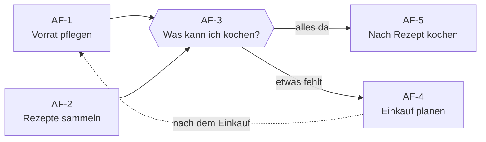
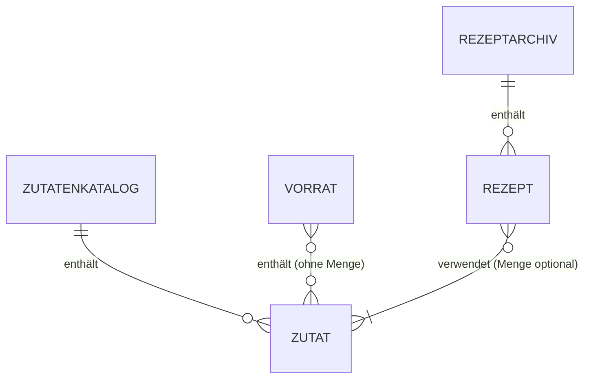

# Anforderungen und User Stories

> [!NOTE]
> Arbeitsentwurf. Mehrere Vorschläge vom 09.11.2026 muss das Team noch bestätigen; die Agenda steht in [mvp.md](mvp.md#noch-in-phase-1-klären).

**Inhalt**

1. [Produktziel](#produktziel)
2. [Zielgruppe und Personas](#zielgruppe-und-personas)
3. [Nutzungskontext](#nutzungskontext)
4. [Wichtigste Anwendungsfälle](#wichtigste-anwendungsfälle)
5. [Begriffe](#begriffe)
6. [Priorisierungsmaßstab](#priorisierungsmaßstab)
7. [Fachliche Regeln](#fachliche-regeln)
8. [User Stories mit Akzeptanzkriterien](#user-stories-mit-akzeptanzkriterien)
9. [Funktionale Anforderungen](#funktionale-anforderungen)
10. [Nichtfunktionale Anforderungen](#nichtfunktionale-anforderungen)
11. [Prüfung auf Widersprüche und Unklarheiten](#prüfung-auf-widersprüche-und-unklarheiten)

## Produktziel

Jausi richtet sich an Menschen, die mit vorhandenen Zutaten kochen möchten, primär Studierende (siehe Personas), und verbindet dafür Lebensmittelvorrat und persönliches Rezeptarchiv. Das vierköpfige Team entwickelt einen überschaubaren MVP im Rahmen eines Semesterprojekts.

## Zielgruppe und Personas

Die Zielgruppe sind Menschen, die mit vorhandenen Zutaten kochen möchten. Ausführliche, fiktive Personas stehen in [personas.md](personas.md): Lena (Studentin, primäre Persona), Andrea (will Lebensmittelverschwendung vermeiden) und Jonas (Kochanfänger). In den User Stories steht „Nutzer“ für alle Personas; wo sich der Nutzen unterscheidet, ist die Persona genannt.

## Nutzungskontext

Jausi wird hauptsächlich auf dem Smartphone genutzt:

- **In der Küche:** nachsehen, welche Rezepte mit dem aktuellen Vorrat möglich sind, und das Rezept beim Kochen lesen.
- **Beim Einkaufen:** fehlende Zutaten eines Rezepts nachsehen und den Vorrat nach dem Einkauf ergänzen.

Die Oberfläche muss daher auf einem Smartphone-Bildschirm vollständig bedienbar sein. Ob Jausi als native App oder als Web-App umgesetzt wird, ist eine Technologieentscheidung und folgt in Phase 2.

## Wichtigste Anwendungsfälle

Jeder Anwendungsfall beschreibt, wer wann warum handelt und was danach gilt. Jede User Story gehört zu mindestens einem Anwendungsfall.

| ID | Anwendungsfall | Persona | Auslöser | Ergebnis | User Stories | Im MVP |
| --- | --- | --- | --- | --- | --- | --- |
| AF-1 | Vorrat pflegen | alle | nach dem Einkauf oder Kochen | Der Vorrat stimmt mit den Zutaten daheim überein. | US-01–03, US-13–15, US-17, US-18 | Ja (Kern) |
| AF-2 | Rezepte sammeln | Jonas | ein neues Gericht gekocht oder entdeckt | Das Rezept ist im Archiv und wiederauffindbar. | US-04–07, US-11, US-13, US-17–19 | Ja (Kern) |
| AF-3 | Was kann ich kochen? | Lena | Hunger, Blick in den Kühlschrank | Ein Rezept ist gewählt, dessen Zutaten alle vorhanden sind. | US-08, US-09 | Ja (Hauptanwendungsfall) |
| AF-4 | Einkauf planen | Andrea | vor dem Wocheneinkauf | Sie weiß, welche Zutaten sie für welche Rezepte nachkaufen muss. | US-09, US-10, US-12 | Teilweise (nur US-09) |
| AF-5 | Nach Rezept kochen | alle | am Herd, Smartphone in der Hand | Das Gericht ist zubereitet, ohne lange im Rezept zu suchen. | US-05, US-16 | Teilweise (nur US-05) |

AF-1 und AF-2 sind die Voraussetzung für den Hauptanwendungsfall AF-3:

<strong>Abläufe der Anwendungsfälle anzeigen</strong>

**AF-1 – Vorrat pflegen**
1. Die Person öffnet den Vorrat.
2. Sie tippt den Namen einer Zutat und wählt einen Zutatenvorschlag oder legt eine neue Zutat an.
3. Verbrauchte Zutaten entfernt sie aus dem Vorrat.
4. Das Matching berücksichtigt sofort den aktuellen Vorrat.

**AF-2 – Rezepte sammeln**
1. Jonas legt ein neues Rezept an und gibt einen eindeutigen Namen ein.
2. Er wählt die Zutaten über Zutatenvorschläge aus oder legt fehlende neu an; Mengen sind optional.
3. Er erfasst die Zubereitung als Freitext und speichert.
4. Das Rezept erscheint im Archiv und kann später bearbeitet oder gelöscht werden.

**AF-3 – Was kann ich kochen?**
1. Lena öffnet Jausi und wählt den Filter für vollständig passende Rezepte.
2. Jausi zeigt alle Rezepte, deren Zutaten im Vorrat stehen.
3. Ist keines dabei, sieht sie in den Rezeptdetails, welche Zutaten fehlen.
4. Sie wählt ein Rezept und öffnet die Zubereitung (weiter mit AF-5).

**AF-4 – Einkauf planen**
1. Andrea öffnet ein Rezept, das sie diese Woche kochen möchte.
2. Jausi zeigt die fehlenden Zutaten.
3. Nach dem MVP: Sie filtert Rezepte mit höchstens zwei fehlenden Zutaten (US-10) und übernimmt fehlende Zutaten auf eine Einkaufsliste (US-12).

**AF-5 – Nach Rezept kochen**
1. Die Person öffnet ein Rezept auf dem Smartphone.
2. Sie liest Zutaten und Zubereitung.
3. Nach dem MVP: Sie klappt nur den aktuellen Abschnitt der Zubereitung auf (US-16).

## Begriffe

Diese Begriffe gelten verbindlich für alle Projektdokumente. Die unter „Nicht verwenden“ genannten Synonyme werden durch den definierten Begriff ersetzt. Wörtliche Zitate früherer Eingaben in [ai-usage.md](ai-usage.md) bleiben unverändert.

- **Zutatenkatalog:** Persönliche Menge eindeutig benannter Zutaten, die mit den Eingaben des Nutzers wächst. Er ist zu Beginn leer. Jede Zutat hat genau eine Schreibweise. Vorrat und Rezepte verwenden ausschließlich Zutaten aus dem Katalog.
  *Nicht verwenden: Zutatenliste.*
- **Vorrat:** Die Zutaten des Zutatenkatalogs, die der Nutzer aktuell zur Verfügung hat. Mengen werden nicht erfasst.
  *Nicht verwenden: Bestand, Vorratsliste, Inventur, Inventurliste.*
- **Rezept:** Gespeicherte Kochanleitung mit Namen, mindestens einer Zutat aus dem Zutatenkatalog und einer Zubereitung als Freitext. Mengen und Einheiten sind optional.
- **Rezeptarchiv:** Alle gespeicherten Rezepte des Nutzers. Kurzform: Archiv.
  *Nicht verwenden: Rezeptliste, Rezeptsammlung.*
- **Zutatenvorschlag:** Zutat aus dem Zutatenkatalog, die beim Eintippen eines Zutatennamens zur Auswahl angezeigt wird (US-13). Nicht zu verwechseln mit dem Matching.
- **Matching:** Abgleich der Zutaten eines Rezepts mit dem Vorrat. Ergebnis ist je Rezept, welche Zutaten vorhanden sind und welche fehlen. Mengen und Einheiten bleiben unberücksichtigt.
  *Nicht verwenden: Rezeptvorschlag.*
- **Vollständig passendes Rezept:** Ein Rezept, dessen Zutaten alle im Vorrat stehen.
- **Fehlende Zutat:** Eine Zutat eines Rezepts, die nicht im Vorrat steht.
- **Favorit:** Ein vom Nutzer markiertes Rezept (Could, nicht im MVP).
  *Nicht verwenden: Lieblingsrezept.*
- **Must / Should / Could:** Prioritätsstufen gemäß Abschnitt „Priorisierungsmaßstab“.

So hängen die Begriffe zusammen:

## Priorisierungsmaßstab

Must-Anforderungen umfassen den vollständigen Kernanwendungsfall auf dem Smartphone, auch ohne Internetverbindung: Zutaten anlegen und im Vorrat erfassen, Rezepte verwalten, passende Rezepte und fehlende Zutaten erkennen sowie alle Daten dauerhaft speichern. Should-Anforderungen verbessern die Nutzung, sind für diesen Ablauf aber nicht notwendig. Could-Anforderungen bieten zusätzlichen Komfort. Die Suche nach Rezeptnamen ist deshalb Should, denn das Rezeptarchiv bleibt auch ohne Suche nutzbar.

## Fachliche Regeln

- Vorrat und Rezepte verwenden ausschließlich Zutaten aus dem Zutatenkatalog. Unterschiedliche Schreibweisen dürfen nicht zu falschen Vergleichen führen; die technische Umsetzung folgt in Phase 2.
- Beim Eingeben einer Zutat werden passende Zutaten aus dem Zutatenkatalog vorgeschlagen. Gibt es keine passende Zutat, legt der Nutzer eine neue an; sie steht danach in Vorrat und Rezepten zur Auswahl.
- Zwei Zutatennamen gelten als gleich, wenn sie sich nur in Groß-/Kleinschreibung oder in Leerzeichen am Anfang oder Ende unterscheiden. In diesem Fall wird die vorhandene Zutat verwendet und keine neue angelegt. Gespeichert bleibt die Schreibweise der ersten Eingabe.
- Ein Zutatenname darf nicht leer sein und nicht nur aus Leerzeichen bestehen.
- Bekannte Einschränkung: Plural- und Schreibvarianten (z. B. „Tomate“ und „Tomaten“) werden nicht als gleich erkannt. Die Vorschläge beim Tippen sollen solche Duplikate vermeiden helfen.
- Der Vorrat enthält nur vorhandene Zutaten. Jede Zutat des Zutatenkatalogs kann höchstens einmal im Vorrat stehen; Zutaten, die nicht im Vorrat stehen, gelten als nicht vorhanden. Einträge im Vorrat haben keine Mengenangaben.
- Ein gültiges Rezept hat einen Namen, mindestens eine Zutat und eine nicht leere Zubereitung. Die Zubereitung ist ein Freitext.
- Jede Zutat kommt in einem Rezept höchstens einmal vor. Wird sie erneut hinzugefügt, erscheint ein Hinweis und es entsteht kein zweiter Eintrag.
- Rezeptnamen sind eindeutig. Zwei Rezeptnamen gelten nach derselben Regel wie Zutatennamen als gleich.
- Mengen und Einheiten sind optionale Rezeptangaben und beeinflussen das Matching nicht.
- Ein Rezept passt vollständig, wenn alle seine Zutaten im Vorrat vorhanden sind. Es erfolgt keine Aussage über ausreichende Mengen.
- Salz, Öl und andere Grundzutaten werden wie alle anderen Zutaten behandelt und nicht automatisch als vorhanden angenommen.
- Änderungen am Vorrat lassen Rezepte und deren Zutaten unverändert. Nach einer Änderung wird das Matching mit dem aktuellen Vorrat berechnet.

## User Stories mit Akzeptanzkriterien

| ID | User Story | Priorität | Anwendungsfall |
| --- | --- | --- | --- |
| US-01 | Als Nutzer möchte ich eine Zutat aus dem Zutatenkatalog zum Vorrat hinzufügen, damit Jausi weiß, welche Rezepte ich kochen kann. | Must | AF-1 |
| US-02 | Als Nutzer möchte ich meinen Vorrat sehen, damit ich vorhandene Lebensmittel überblicken kann. | Must | AF-1 |
| US-03 | Als Nutzer möchte ich verbrauchte Zutaten entfernen, damit mein Vorrat aktuell bleibt. | Must | AF-1 |
| US-04 | Als Nutzer möchte ich ein Rezept anlegen, damit ich es später wieder verwenden kann. | Must | AF-2 |
| US-05 | Als Nutzer möchte ich das Rezeptarchiv und einzelne Rezepte öffnen, damit ich Zutaten und Zubereitung lesen kann. | Must | AF-2, AF-5 |
| US-06 | Als Nutzer möchte ich ein Rezept bearbeiten, damit ich Korrekturen und Änderungen festhalten kann. | Must | AF-2 |
| US-07 | Als Nutzer möchte ich Rezepte nach Namen suchen, damit ich ein bestimmtes Gericht finde. | Should | AF-2 |
| US-08 | Als Nutzerin wie Lena möchte ich vollständig passende Rezepte anzeigen, damit ich ohne Einkauf schnell etwas kochen kann. | Must | AF-3 |
| US-09 | Als Nutzer möchte ich fehlende Zutaten sehen, damit ich meinen Einkauf planen kann. | Must | AF-3, AF-4 |
| US-10 | Als Nutzerin wie Andrea möchte ich Rezepte mit höchstens zwei fehlenden Zutaten finden, damit ich vorhandene Lebensmittel aufbrauche, statt viel neu einzukaufen. | Should | AF-4 |
| US-11 | Als Nutzer möchte ich Rezepte als Favoriten markieren, damit ich sie schnell wiederfinde. | Could | AF-2 |
| US-12 | Als Nutzer möchte ich fehlende Zutaten auf eine Einkaufsliste übernehmen, damit ich sie gesammelt sehe. | Could | AF-4 |
| US-13 | Als Nutzer möchte ich beim Eintippen einer Zutat passende Zutaten aus meinem Zutatenkatalog vorgeschlagen bekommen, damit ich schnell auswähle, statt neu zu tippen. | Must | AF-1, AF-2 |
| US-14 | Als Nutzer möchte ich Zutaten umbenennen oder zusammenführen, damit ich Tippfehler und Duplikate korrigieren kann. | Should | AF-1 |
| US-15 | Als Nutzer möchte ich unbenutzte Zutaten löschen, damit der Zutatenkatalog übersichtlich bleibt. | Could | AF-1 |
| US-16 | Als Nutzer möchte ich die Zubereitung eines Rezepts in Abschnitte gliedern, damit ich beim Kochen nur den aktuellen Teil sehe, etwa „Boden“, „Füllung“ oder „Glasur“. | Could | AF-5 |
| US-17 | Als Nutzer möchte ich eine Zutat neu anlegen, wenn sie noch nicht im Zutatenkatalog steht, damit ich alle Zutaten meiner eigenen Rezepte verwenden kann. | Must | AF-1, AF-2 |
| US-18 | Als Nutzer möchte ich, dass Jausi doppelte Zutaten verhindert, damit das Matching nicht an unterschiedlichen Schreibweisen scheitert. | Must | AF-1, AF-2 |
| US-19 | Als Nutzer möchte ich ein Rezept löschen, damit mein Archiv nur Rezepte enthält, die ich noch nutze. | Must | AF-2 |

US-06 und US-19 sowie US-13, US-17 und US-18 entstanden am 09.11.2026 durch Aufteilung größerer Stories, damit jede Story einzeln umsetzbar und testbar ist.

### Akzeptanzkriterien

Alle Kriterien folgen dem Format **Gegeben / Wenn / Dann**. Der genaue Wortlaut von Hinweistexten kann im Design (Phase 2) angepasst werden; ihre Aussage bleibt gleich.

<strong>Must-Stories</strong>

**US-01 – Zutat zum Vorrat hinzufügen**
- **Gegeben** „Reis“ steht im Zutatenkatalog, aber nicht im Vorrat, **wenn** die Person „Reis“ zum Vorrat hinzufügt, **dann** steht „Reis“ im Vorrat.
- **Gegeben** „Reis“ steht bereits im Vorrat, **wenn** die Person „Reis“ erneut hinzufügt, **dann** steht „Reis“ weiterhin genau einmal im Vorrat.

**US-02 – Vorrat anzeigen**
- **Gegeben** der Vorrat enthält Reis und Tomate, **wenn** die Person den Vorrat öffnet, **dann** werden genau Reis und Tomate angezeigt.
- **Gegeben** der Vorrat ist leer, **wenn** die Person den Vorrat öffnet, **dann** erscheint der Hinweis „Noch keine Zutaten im Vorrat“, und das Hinzufügen einer Zutat ist mit einem Tipp erreichbar.

**US-03 – Zutat aus dem Vorrat entfernen**
- **Gegeben** Tomate steht im Vorrat und im Rezept „Tomatenreis“, **wenn** die Person Tomate aus dem Vorrat entfernt, **dann** steht Tomate nicht mehr im Vorrat, das Rezept „Tomatenreis“ bleibt unverändert und zeigt Tomate als fehlende Zutat.

**US-04 – Rezept anlegen**
- **Gegeben** es gibt kein Rezept „Tomatenreis“, **wenn** die Person ein Rezept mit dem Namen „Tomatenreis“, den Zutaten Reis und Tomate und einer Zubereitung speichert, **dann** erscheint es im Archiv.
- **Gegeben** Name, Zutaten oder Zubereitung fehlen, **wenn** die Person speichert, **dann** wird nicht gespeichert, und eine Fehlermeldung nennt das fehlende Feld.
- **Gegeben** es gibt bereits „Tomatenreis“, **wenn** die Person ein neues Rezept „tomatenreis“ speichert, **dann** wird nicht gespeichert, und eine Fehlermeldung weist auf den vorhandenen Namen hin.
- **Gegeben** Reis steht bereits im Rezept, **wenn** die Person Reis erneut hinzufügt, **dann** erscheint ein Hinweis, und Reis steht weiterhin genau einmal im Rezept.

**US-05 – Archiv und Rezept öffnen**
- **Gegeben** das Archiv enthält „Tomatenreis“ und „Eierreis“, **wenn** die Person das Archiv öffnet, **dann** werden beide Rezepte mit Namen angezeigt.
- **Gegeben** ein Rezept mit Zutaten, Mengenangaben und Zubereitung, **wenn** die Person es öffnet, **dann** werden alle erfassten Angaben angezeigt.
- **Gegeben** das Archiv ist leer, **wenn** die Person es öffnet, **dann** erscheint der Hinweis „Noch keine Rezepte“, und das Anlegen eines Rezepts ist mit einem Tipp erreichbar.

**US-06 – Rezept bearbeiten**
- **Gegeben** ein gespeichertes Rezept, **wenn** die Person die Zubereitung ändert und speichert, **dann** ist die Änderung nach erneutem Öffnen sichtbar.
- **Gegeben** die Änderung verletzt eine Regel aus US-04, etwa ein leerer Name, **wenn** die Person speichert, **dann** wird nicht gespeichert, und eine Fehlermeldung erscheint.

**US-08 – Vollständig passende Rezepte anzeigen**
- **Gegeben** der Vorrat enthält Reis und Tomate, das Archiv „Tomatenreis“ (Reis, Tomate) und „Eierreis“ (Reis, Ei), **wenn** die Person den Filter für vollständig passende Rezepte wählt, **dann** wird nur „Tomatenreis“ angezeigt.
- **Gegeben** ein Rezept verlangt „500 g Reis“ und Reis steht im Vorrat, **wenn** das Matching läuft, **dann** gilt Reis als vorhanden; Mengen werden nicht geprüft.
- **Gegeben** kein Rezept passt vollständig, **wenn** die Person den Filter wählt, **dann** erscheint der Hinweis „Keine Rezepte mit allen Zutaten vorhanden“.

**US-09 – Fehlende Zutaten anzeigen**
- **Gegeben** der Vorrat enthält Reis, das Rezept „Eierreis“ verlangt Reis und Ei, **wenn** die Person „Eierreis“ öffnet, **dann** wird genau Ei als fehlende Zutat angezeigt.
- **Gegeben** alle Zutaten von „Tomatenreis“ stehen im Vorrat, **wenn** die Person es öffnet, **dann** erscheint „Alle Zutaten vorhanden – Mengen nicht geprüft“.

**US-13 – Zutatenvorschläge beim Tippen**
- **Gegeben** „Reis“ und „Paprika“ stehen im Zutatenkatalog, **wenn** die Person „RE“ eintippt, **dann** wird „Reis“ vorgeschlagen und „Paprika“ nicht.
- **Gegeben** „Reis“ wird vorgeschlagen, **wenn** die Person den Vorschlag wählt, **dann** wird „Reis“ übernommen, ohne dass eine neue Zutat entsteht.

**US-17 – Neue Zutat anlegen**
- **Gegeben** „Ei“ steht nicht im Zutatenkatalog, **wenn** die Person „Ei“ eintippt und neu anlegt, **dann** steht „Ei“ im Zutatenkatalog und ist in Vorrat und Rezepten auswählbar.
- **Gegeben** die Eingabe ist leer oder besteht nur aus Leerzeichen, **wenn** die Person eine Zutat anlegen will, **dann** wird keine Zutat angelegt, und ein Hinweis erscheint.

**US-18 – Doppelte Zutaten verhindern**
- **Gegeben** „Reis“ steht im Zutatenkatalog, **wenn** die Person „ reis “ neu anlegen will, **dann** wird keine neue Zutat angelegt, sondern „Reis“ verwendet.
- **Gegeben** „Tomate“ steht im Zutatenkatalog, **wenn** die Person „Tomaten“ anlegt, **dann** entsteht eine zweite Zutat. Das ist die dokumentierte Einschränkung bei Pluralformen.

**US-19 – Rezept löschen**
- **Gegeben** ein gespeichertes Rezept, **wenn** die Person „Löschen“ wählt, **dann** erscheint eine Sicherheitsabfrage.
- **Gegeben** die Sicherheitsabfrage, **wenn** die Person bestätigt, **dann** ist das Rezept nicht mehr im Archiv, und seine Zutaten bleiben im Zutatenkatalog; **wenn** sie abbricht, bleibt das Rezept unverändert.

<strong>Should- und Could-Stories</strong>

**US-07 – Rezepte suchen** (Should)
- **Gegeben** das Archiv enthält „Tomatenreis“ und „Eierreis“, **wenn** die Person „REIS“ sucht, **dann** werden beide Rezepte angezeigt.
- **Gegeben** kein Rezeptname enthält den Suchbegriff, **wenn** die Person sucht, **dann** erscheint der Hinweis „Keine Rezepte gefunden“.

**US-10 – Höchstens zwei fehlende Zutaten** (Should)
- **Gegeben** drei Rezepte, denen null, zwei und drei Zutaten fehlen, **wenn** die Person den Filter „höchstens zwei fehlende Zutaten“ wählt, **dann** werden die Rezepte mit null und zwei fehlenden Zutaten samt Anzahl angezeigt, das mit drei nicht.

**US-11 – Favoriten** (Could)
- **Gegeben** ein Rezept, **wenn** die Person es als Favorit markiert, **dann** erscheint es im Favoritenfilter; **wenn** sie die Markierung entfernt, **dann** nicht mehr.

**US-12 – Einkaufsliste** (Could)
- **Gegeben** Ei fehlt für „Eierreis“ und steht bereits auf der Einkaufsliste, **wenn** die Person die fehlenden Zutaten von „Eierreis“ übernimmt, **dann** steht Ei genau einmal auf der Einkaufsliste.

**US-14 – Zutaten umbenennen oder zusammenführen** (Should)
- **Gegeben** „Tomatte“ steht im Vorrat und im Rezept „Tomatenreis“, **wenn** die Person sie in „Tomate“ umbenennt, **dann** erscheint „Tomate“ in Vorrat und Rezept.
- **Gegeben** „Tomate“ und „Tomaten“ existieren, **wenn** die Person „Tomaten“ mit „Tomate“ zusammenführt, **dann** verweisen Vorrat und alle Rezepte nur noch auf „Tomate“, und „Tomaten“ ist nicht mehr im Zutatenkatalog.

**US-15 – Unbenutzte Zutaten löschen** (Could)
- **Gegeben** „Zimt“ kommt weder im Vorrat noch in einem Rezept vor, **wenn** die Person „Zimt“ löscht, **dann** ist „Zimt“ nicht mehr im Zutatenkatalog.
- **Gegeben** „Reis“ kommt in einem Rezept vor, **wenn** die Person „Reis“ löschen will, **dann** ist das nicht möglich, und ein Hinweis nennt den Grund.

**US-16 – Abschnitte in der Zubereitung** (Could)
- **Gegeben** ein Rezept mit den Abschnitten „Boden“ und „Füllung“, **wenn** die Person nur „Füllung“ aufklappt, **dann** ist nur deren Text sichtbar, und die Zutaten stehen weiterhin in einer gemeinsamen Liste.
- **Gegeben** ein Rezept ohne Abschnitte, **wenn** die Person es speichert, **dann** ist es gültig.

## Funktionale Anforderungen

| ID | Anforderung | Priorität | Bezug |
| --- | --- | --- | --- |
| FR-01 | Das System führt einen persönlichen Zutatenkatalog: Es schlägt beim Eintippen passende Zutaten vor, legt fehlende Zutaten neu an und verhindert Duplikate gemäß den fachlichen Regeln. | Must | US-01, US-04, US-13, US-17, US-18 |
| FR-02 | Das System zeigt den Vorrat an und erlaubt, Zutaten aus dem Zutatenkatalog hinzuzufügen und zu entfernen; jede Zutat steht höchstens einmal im Vorrat. | Must | US-01–03 |
| FR-03 | Das System erlaubt, Rezepte anzulegen, anzuzeigen, zu bearbeiten und nach einer Sicherheitsabfrage zu löschen, und prüft dabei die Regeln für gültige Rezepte. | Must | US-04–06, US-19 |
| FR-04 | Das System findet Rezepte, deren Name den Suchbegriff enthält, ohne Beachtung der Groß-/Kleinschreibung. | Should | US-07 |
| FR-05 | Das System berechnet für jedes Rezept die fehlenden Zutaten aus dem aktuellen Vorrat und bietet einen Filter für vollständig passende Rezepte. | Must | US-08, US-09 |
| FR-06 | Das System speichert Zutatenkatalog, Vorrat und Rezepte dauerhaft, sodass sie nach einem Neustart unverändert vorhanden sind. | Must | US-01–06, US-08, US-09, US-13, US-17–19 |
| FR-07 | Das System filtert Rezepte mit höchstens zwei fehlenden Zutaten und zeigt deren Anzahl. | Should | US-10 |
| FR-08 | Das System erlaubt, Rezepte als Favoriten zu markieren und nach Favoriten zu filtern. | Could | US-11 |
| FR-09 | Das System übernimmt die fehlenden Zutaten eines Rezepts ohne Duplikate auf eine Einkaufsliste. | Could | US-12 |
| FR-10 | Das System erlaubt, Zutaten umzubenennen und zusammenzuführen, und aktualisiert dabei Vorrat und alle Rezepte. | Should | US-14 |
| FR-11 | Das System erlaubt, Zutaten zu löschen, die weder im Vorrat noch in einem Rezept vorkommen. | Could | US-15 |
| FR-12 | Das System erlaubt, die Zubereitung in benannte, einklappbare Abschnitte zu gliedern. | Could | US-16 |

## Nichtfunktionale Anforderungen

| ID | Anforderung und Prüfung | Priorität |
| --- | --- | --- |
| NFR-01 | Deutschsprachige Oberfläche, die auf einem Smartphone-Bildschirm mit 360 Pixel Breite ohne horizontales Scrollen bedienbar ist; Vorrat und Archiv sind von der Hauptnavigation mit einem Tipp erreichbar. Prüfung durch manuellen Durchlauf aller Must-Stories auf dem dokumentierten Testgerät. | Must |
| NFR-02 | Matching (US-08, US-09): Mit dem Referenzdatensatz erscheinen die vollständig passenden Rezepte und die fehlenden Zutaten je Rezept innerhalb einer Sekunde auf dem dokumentierten Testgerät. | Should |
| NFR-03 | Nach Speichern und Neustart sind Zutatenkatalog, Vorrat und Rezepte unverändert vorhanden. Prüfung mit einem gespeicherten Beispieldatensatz. | Must |
| NFR-04 | Fehlermeldungen nennen das betroffene Feld und den Grund; bereits eingegebene Daten bleiben nach einer Fehlermeldung erhalten. Löschende Aktionen erfordern eine Sicherheitsabfrage. Prüfung mit ungültigen Eingaben und Abbruch einer Löschaktion. | Must |
| NFR-05 | Das Matching ist unabhängig von der Oberfläche testbar; automatisierte Tests prüfen vollständige, teilweise und fehlende Übereinstimmung sowie leeren Vorrat. | Must |
| NFR-06 | Der MVP erfordert keine personenbezogenen Angaben und übermittelt Vorrats- oder Rezeptdaten an keinen AI-Dienst. Prüfung der Eingabefelder und Datenflüsse. | Must |
| NFR-07 | Zutatenvorschläge (US-13): Mit dem Referenzdatensatz erscheinen die Zutatenvorschläge innerhalb einer Sekunde nach jeder Eingabe auf dem dokumentierten Testgerät. | Should |
| NFR-08 | Suche (US-07): Mit dem Referenzdatensatz erscheinen die Suchergebnisse innerhalb einer Sekunde auf dem dokumentierten Testgerät. Gilt nur, wenn die Suche umgesetzt wird. | Should |
| NFR-09 | Alle Must-Stories funktionieren ohne Internetverbindung. Prüfung durch manuellen Durchlauf aller Must-Stories im Flugmodus. | Must |
| NFR-10 | Rezepte sind beim Kochen gut lesbar: Fließtext in der Rezeptansicht mindestens 16 Pixel groß, Kontrast zwischen Text und Hintergrund mindestens 4,5:1 (WCAG 2.1, Stufe AA). Prüfung auf dem dokumentierten Testgerät mit einem Kontrast-Prüfwerkzeug. | Should |

**Referenzdatensatz für NFR-02, NFR-07 und NFR-08:** 200 Zutaten im Zutatenkatalog, die alle im Vorrat stehen, und 100 Rezepte mit je bis zu 20 Zutaten. Die Datenmengen sind ein Referenzwert für die Messung, keine Obergrenze. Testgerät und Messmethode werden nach Festlegung der Plattform dokumentiert.

## Prüfung auf Widersprüche und Unklarheiten

Befunde aus den AI-Prüfungen vom 14.10., 07.11. und 09.11.2026. Überholte Befunde bleiben zur Nachvollziehbarkeit stehen und sind als solche markiert.

| Befund | Bewertung und Korrektur |
| --- | --- |
| Suche war Must, obwohl der Kernablauf über das Rezeptarchiv möglich ist. | US-07 und FR-04 auf Should gesetzt; MVP entsprechend angepasst. |
| Produktabnahme und Phase-1-Abschluss waren vermischt. | Separate Definition of Done für die Spezifikation ergänzt; App-Tests sind erst später auszuführen. |
| Technische Vorbereitung wurde zu früh empfohlen. | Technologieauswahl und Architektur auf Phase 2 verschoben; keine Implementierungsarbeiten in Phase 1. |
| Ein Zutatenkatalog begrenzt die erfassbaren Lebensmittel. | **Überholt (09.11.2026):** Ursprünglich sollte das Team einen festen Startumfang festlegen. Ersetzt durch den mitwachsenden Zutatenkatalog (siehe letzte Zeile dieser Tabelle); ein Startumfang ist nicht mehr nötig. |
| Die Leistungsgrenze war ein AI-Vorschlag ohne Teamvalidierung. | **Aktualisiert (09.11.2026):** Aufgeteilt in NFR-02, NFR-07 und NFR-08 mit gemeinsamem Referenzdatensatz; alle drei sind Should. Gemeinsame Bestätigung steht aus. |
| Externe Abhängigkeiten und Kosten waren nicht explizit behandelt. | Der MVP verlangt keine externen APIs oder kostenpflichtigen Dienste. Falls später welche gewählt werden, sind Verfügbarkeit, Kosten und Abhängigkeiten zu dokumentieren. |
| Manche Texte waren unklar, Begriffe waren inkonsistent. | Review durch AI und manuelles Review; verständlichere, konsistente Formulierungen und Abschnitt „Begriffe“ ergänzt. |
| Ein vorgegebener Zutatenkatalog verhindert eigene Rezepte mit Zutaten, die nicht im Katalog stehen; damit scheitert der Kernablauf für diese Nutzer. | Vorschlag aus dem Team (09.11.2026): Der Zutatenkatalog wächst mit den Eingaben des Nutzers (US-13, Must). Komfortfunktionen sind Should bzw. Could (US-14, US-15). Der feste Katalog entfällt, die Anzahl der Must-Anforderungen bleibt bei den funktionalen Anforderungen gleich. Teamentscheidung ausstehend. |

- „Zutat vorhanden“ bedeutet nicht, dass die Menge ausreicht. Die Oberfläche muss diese Einschränkung sichtbar machen.
- Der Vorrat ist im MVP eine Liste vorhandener Zutaten, keine mengengenaue Bestandsführung.
- Mengenangaben im Rezept und mengenunabhängiges Matching sind bewusst getrennt.
- Der Zutatenkatalog ist zu Beginn leer und wächst mit den Eingaben des Nutzers. Ein vorgegebener Startumfang ist daher nicht nötig. Umbenennen, Zusammenführen und Löschen von Zutaten gehören nicht zum MVP.
- Dauerhafte Speicherung ist verbindlich; Plattform und Speichermethode sind noch offen.
- Der MVP verwendet einen persönlichen Datenbestand ohne Anmeldung, gemeinsam genutzten Haushalt oder Synchronisierung.
- Bekannte Einschränkung: Die Daten liegen nur auf dem eigenen Gerät. Geht das Smartphone verloren oder wird die App gelöscht, sind Zutatenkatalog, Vorrat und Rezepte verloren. Sicherung, Export und Synchronisierung gehören nicht zum MVP.
- Ein Ablaufdatum ist eine spätere Idee, keine Anforderung für die aktuelle Umsetzung.
- Bekanntes Risiko (AF-1): Nach einem großen Einkauf müssen Zutaten einzeln eingetragen werden. Ist das zu mühsam, wird der Vorrat nicht gepflegt und das Matching verliert seinen Wert. Mehrere Zutaten auf einmal hinzuzufügen wäre eine mögliche spätere Erweiterung; sie ist noch nicht als Anforderung erfasst.
- Bekannte Einschränkung (AF-3): Jausi bringt erst Nutzen, wenn Rezepte im Archiv stehen. Beim ersten Start findet das Matching nichts (siehe Persona Jonas).

Die Spezifikation ist ein Arbeitsentwurf. Vor Abschluss von Phase 1 bestätigt das Team die offenen Punkte in [mvp.md](mvp.md), Abschnitt „Noch in Phase 1 klären“. Technische Entscheidungen bleiben Phase 2 vorbehalten.
